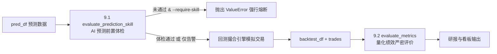

# Kronos-Pro 量化回测系统完全解析与认知实战手册

> 统一调度门面：[run_backtest_kronos_pro.py](file:///Users/jyy/Documents/github_projects/Kronos/backtest/run_backtest_kronos_pro.py) (Facade 入口，支持 CLI 与 Streamlit 单标的看板)  
> 多市场规则内核：[core/market_rules.py](file:///Users/jyy/Documents/github_projects/Kronos/backtest/core/market_rules.py) (A股 / 港股 / 美股 全真制度与微观摩擦画像)  
> 批量回测调度：[run_backtest_batch.py](file:///Users/jyy/Documents/github_projects/Kronos/backtest/run_backtest_batch.py) (多标的股票池编排、并发准备与大盘排行榜)  
> 统一看板中枢：[app_backtest_dashboard.py](file:///Users/jyy/Documents/github_projects/Kronos/backtest/app_backtest_dashboard.py) (大盘池化筛选 + 单股穿透深度下钻)  
> 模块化解耦体系：[core/](file:///Users/jyy/Documents/github_projects/Kronos/backtest/core) · [engine/](file:///Users/jyy/Documents/github_projects/Kronos/backtest/engine) · [strategies/](file:///Users/jyy/Documents/github_projects/Kronos/backtest/strategies) · [execution/](file:///Users/jyy/Documents/github_projects/Kronos/backtest/execution) · [data/](file:///Users/jyy/Documents/github_projects/Kronos/backtest/data) · [visualizer/](file:///Users/jyy/Documents/github_projects/Kronos/backtest/visualizer)  
> 多周期与自定义策略范例：[run_custom_strategy.py](file:///Users/jyy/Documents/github_projects/Kronos/backtest/run_custom_strategy.py)

---

## 学习路线图与目录

本手册按照**「第一性原理 -> 物理约束 -> 时序因果 -> 信号工程 -> 风险门禁 -> 头寸管理 -> 状态机出场 -> 端到端闭环 -> 双重评价体系 -> 工程交付」**的认知梯度递进组织。

```text
【阶梯 0: 内核原理】 1. 量化回测第一性原理与 30 行最小状态机原型 (Cash + Shares + NAV)
       ↓
【阶梯 1: 物理规则】 2. 真实世界的物理约束与微观摩擦建模 (整手/T+N/税费/滑点/涨跌停)
       ↓
【阶梯 2: 因果律】   3. 时序因果律与防偷价铁律 (Point-in-Time、shift(1) 与 hist_df)
       ↓
【阶梯 3: 信号生成】 4. AI 预测到量化交易信号 (特征解耦/去偏/根号时间/Z-Score/粒子滤波与 pred_df)
       ↓
【阶梯 4: 门禁过滤】 5. 守门人机制：九重入场否决矩阵 (过滤假突破/逆势、veto_reason 与 signal_df)
       ↓
【阶梯 5: 头寸管理】 6. 机构级风险预算定仓 (Risk-Budgeted Sizing、ATR 止损反推、一手保底)
       ↓
【阶梯 6: 出场防守】 7. 离散状态机多维离场体系 (六重出场、动量跃迁、trades 台账与 backtest_df)
       ↓
【阶梯 7: 数据闭环】 8. 端到端全链路数据流实战闭环演练 (以 300418 为例的完整数值推导穿透)
       ↓
【阶梯 8: 成败裁判】 9. 双重评价体系：前置 AI 体检 (12项) + 后置量化绩效严密修正 (22项)
       ↓
【阶梯 9: 工程底座】 10. 工业化推演体系与交付生态 (Walk-Forward、指纹缓存、CLI、Streamlit、交互图表)
       ↓
【阶梯 10: 变量总表】 11. 附录：38 项控制参数与 34 项指标端到端数据流向速查字典
       ↓
【阶梯 11: 架构演进】 12. 港美股多周期与生产级模块化架构演进手册 (V2.0 工业化重构)
```

---

### 详细章节目录

1. [量化回测的第一性原理与极简状态机](#1-量化回测的第一性原理与极简状态机)
   - 1.1 回测的本质：三个核心变量与逐日盯市
   - 1.2 最小可行回测原型 (30行代码)
   - 1.3 玩具原型的致命缺陷：从理想数学到真实市场的六大致命陷阱
2. [真实世界的物理约束与微观摩擦建模](#2-真实世界的物理约束与微观摩擦建模)
   - 2.1 交易所微观规则画像 (`MarketProfile`)
   - 2.2 渐进演进：为最小原型注入交易摩擦与整手规则 (原型演进 v1.5)
3. [时序因果律与防偷价铁律 (Anti-Lookahead)](#3-时序因果律与防偷价铁律-anti-lookahead)
   - 3.1 偷价现象的本质与灾难性后果
   - 3.2 时点不变量 (Point-in-Time Invariant)
   - 3.3 为什么全链路严格统一使用 `shift(1)` 对齐？
   - 3.4 原始历史行情数据结构 (`hist_df`)
4. [从 AI 预测到量化交易信号 (Prediction to Signal)](#4-从-ai-预测到量化交易信号-prediction-to-signal)
   - 4.1 蒙特卡洛多路径采样与特征解耦 (期望均值 vs 波峰中位数 vs 保守下探)
   - 4.2 动态去偏机制 (Debias)：消除深度模型的系统性泡沫
   - 4.3 波动率的时界根号缩放 (Square-Root of Time)
   - 4.4 绝对 Z-Score 信息信噪比门槛筛选
   - 4.5 进阶玩法：粒子滤波 (Particle Filtering / 玩法 B)
   - 4.6 模型预测输出数据结构 (`pred_df`)
5. [守门人机制：九重入场否决矩阵 (9-Stage Risk Veto)](#5-守门人机制九重入场否决矩阵-9-stage-risk-veto)
   - 5.1 为什么高 Z-Score 信号依然不能直接买入？
   - 5.2 九重审查流水线明细剖析
   - 5.3 审查阶段判定逻辑、阈值与 `veto_reason` 归因对照表
   - 5.4 信号对齐矩阵数据结构 (`signal_df`)
6. [头寸管理：机构级风险预算定仓 (Risk Budgeting)](#6-头寸管理机构级风险预算定仓-risk-budgeting)
   - 6.1 机构定仓第一性原理：以风险定仓位
   - 6.2 动态 ATR 止损空间反推下单股数数学推导
   - 6.3 现金与仓位上限截断 + 整手向下取整
   - 6.4 高单价标的一手保底机制 (`min_lot_guarantee`) 与连亏降仓防守
7. [持仓管理：离散状态机多维离场体系 (Exit State Machine)](#7-持仓管理离散状态机多维离场体系-exit-state-machine)
   - 7.1 买入只是开始，卖出决定盈亏
   - 7.2 状态机判定流转拓扑图 (Mermaid)
   - 7.3 六重出场防守规则与具体数值
   - 7.4 逐日净值记录 (`backtest_df`) 与交易流水台账 (`trades`)
8. [端到端全链路数据流实战闭环演练 (End-to-End Walkthrough)](#8-端到端全链路数据流实战闭环演练-end-to-end-walkthrough)
   - 8.1 六大核心数据结构的生命周期流转图
   - 8.2 以 300418 创业板标的为例的全流程数值穿透实战演练 (Stage 0 ~ Stage 8 完整推导)
9. [成败裁判：双重评价体系 (Dual Evaluation System)](#9-成败裁判双重评价体系-dual-evaluation-system)
   - 9.1 前置体检：AI 预测能力前置体检字典 (`evaluate_prediction_skill` 12项指标)
   - 9.2 传统量化指标的三大陷阱与 Kronos Pro 严密修正
   - 9.3 策略量化绩效评价与风险归因字典 (`evaluate_metrics` 22项指标)
   - 9.4 机构级策略多维综合评级雷达
10. [工业化推演体系与交付生态 (Engineering & Ecosystem)](#10-工业化推演体系与交付生态-engineering--ecosystem)
    - 10.1 Walk-Forward 滚动前向推演体系与指纹缓存机制
    - 10.2 常用 CLI 命令行指令全集 (含硬件加速与日志治理)
    - 10.3 Streamlit 交互式量化中枢
    - 10.4 研报与深度可视化分析体系 (WebUI / Plotly 连续光标 / 静态4联图)
11. [附录：回测全参数全指标端到端数据流向与变量速查总表](#11-附录回测全参数全指标端到端数据流向与变量速查总表)
    - 11.1 40 项策略核心控制参数端到端流向总表
    - 11.2 34 项回测评估指标端到端流向总表
12. [港美股多周期与生产级模块化架构演进手册 (V2.0 工业化重构)](#12-港美股多周期与生产级模块化架构演进手册-v20-工业化重构)
    - 12.1 巨石架构拆解与分层解耦全景蓝图 (To-Be)
    - 12.2 港美股为主的高保真交易制度与微观画像
    - 12.3 多时间粒度 (15m/30m/60m/1d) 回测与科学年化校准
    - 12.4 可插拔策略开发体系 (BaseStrategy)
    - 12.5 实盘与仿真统一执行层 (Unified Broker Layer)
    - 12.6 实操运行指南与快速上手

---

## 1. 量化回测的第一性原理与极简状态机

### 1.1 回测的本质：三个核心变量与逐日盯市
量化回测（Backtesting）的本质是：**在历史时间序列上，带着预设的初始资金，按照一套可量化的确定性规则模拟下达交易指令，并实时跟踪账户现金与持仓资产的变化。**

任何量化回测系统，剥去复杂的前端展示、宏观归因和高维数学后，底层的极简状态机仅包含 3 个核心状态变量：
- **`cash`（现金账户）**：当前账户内可供调配的自由可用资金。
- **`shares`（持仓股数）**：当前持有的标的股份总数。
- **`cost_basis`（持仓成本均价）**：建仓与加仓的成交均价。

在每个交易日收盘时，执行**逐日盯市（Mark-to-Market, MTM）**估值：
```text
账户总资产 (portfolio_value) = 现金 (cash) + 持仓股数 (shares) * 当日收盘价 (close)
```

### 1.2 最小可行回测原型 (30行代码)
理解整个回测系统（由统一调度门面 `run_backtest_kronos_pro.py` 与解耦内核组件协同驱动）的第一步，是看懂它的极简数学骨架：

```python
import pandas as pd

def minimal_backtest(df: pd.DataFrame, initial_cash: float = 100000.0):
    cash = initial_cash
    shares = 0
    records = []

    for date, row in df.iterrows():
        close = row['close']
        signal = row['signal']  # 1 为买入，0 为平仓观望

        # 1. 状态转移：执行交易动作
        if signal == 1 and shares == 0:
            shares = int(cash // close)       # 满仓买入
            cash -= shares * close
        elif signal == 0 and shares > 0:
            cash += shares * close            # 全部平仓
            shares = 0

        # 2. 逐日盯市：结算每日总市值
        portfolio_value = cash + shares * close
        records.append({
            'date': date,
            'portfolio_value': portfolio_value,
            'cash': cash,
            'shares': shares,
            'close': close
        })

    return pd.DataFrame(records).set_index('date')
```

### 1.3 玩具原型的致命缺陷：从理想数学到真实市场的六大致命陷阱
以上 30 行最小原型仅展示了资金与持仓的纯数学记账关系。如果直接在真实市场按此执行，会导致回测收益率几十倍、实盘迅速爆仓亏损。

`run_backtest_kronos_pro.py` 的重构初衷，就是彻底铲除初级回测中常见的 **6 大致命陷阱**：

| 陷阱类型 | 初级脚本的错误做法 (玩具原型) | 实盘惨痛代价 | Kronos Pro 工业级解决方案 |
| :--- | :--- | :--- | :--- |
| **1. 未来函数 (偷价)** | 用 t 日收盘价预测，在当天开盘甚至收盘直接成交 | 回测暴利，实盘当天根本不可能预知未来走势 | **严格时点约束**：t-1 收盘产生特征与预测，t 日开盘执行撮合 |
| **2. 虚假样本重叠** | 历史数据止于今日，预测数据位于未来，区间脱节 | 纯外推未经历真实历史检验，毫无统计意义 | **强制重叠门禁**：历史 ∩ 预测 必须 >= 10 天，否则拒绝运行 |
| **3. 信号死锁** | 使用 `signal.ffill()` 填充，一次买入后无状态管理 | 遭遇震荡市持续被动持仓，无法止损止盈 | **离散状态机**：逐日追踪持仓天数、最高价、自适应止损线 |
| **4. 无视真实摩擦** | 随意买入小数股，零滑点，零手续费，不限涨跌停 | 实盘手续费和滑点一口口吃光全部理论 Alpha | **全真微观建模**：100股整手、万三佣金(保底5元)、印花税、滑点0.1% |
| **5. 缺乏主动防守** | 信号不消失就死扛到底，单次回撤 -30% 以上 | 一次深度暴跌直接使本金腰斩出局 | **多维防御体系**：盘中止损、ATR硬止损、移动止盈、波峰离场 |
| **6. 单点静态预测** | 仅依赖历史单次推演拟合，过拟合严重 | 市场周期切换后策略立刻失效 | **Walk-Forward 滚动前向推演**：步进滑动窗口模拟实盘迭代 |

---

## 2. 真实世界的物理约束与微观摩擦建模

### 2.1 交易所微观规则画像 (`MarketProfile`)
在二级市场中，不同国家与交易所的交易规则存在巨大物理差异。回测引擎通过 [core/market_rules.py](file:///Users/jyy/Documents/github_projects/Kronos/backtest/core/market_rules.py) 中的 `MarketProfile` 抽象出微观环境画像：

- **A 股 (`CN`)**：
  - **整手申报限制 (`lot_size = 100`)**：买入数量必须为 100 股的整数倍，零股无法买入；
  - **交收周期 (`settlement_days = 1`)**：严格 T+1 制度，当天买入的股票当天被物理锁定，不可卖出；
  - **卖方单边印花税 (`stamp_duty = 0.05%`)**：平仓卖出时按总成交额计征；
  - **券商交易佣金 (`commission = 0.03%`)**：双边收取，且设有**单笔最低 5 元人民币保底**；
  - **价格涨跌幅限制 (`price_limit_pct`)**：主板 10%、创业板/科创板 20%、ST 股票 5%。开盘一字涨停禁止买入挂单，开盘一字跌停禁止卖出平仓；
  - **做空机制**：普通现货账户严禁裸做空 (`allow_short = False`)；
  - **年化交易日基数**：`annual_trading_days = 244`。
- **港股 (`HK`)**：
  - **分股一手制度**：每只股票法定一手股数各异（如腾讯 `00700` 为 100 股，小米 `01810` 为 200 股，比亚迪 `01211` 为 500 股）；
  - **交收制度**：T+0 交易（当天可买卖）；
  - **印花税**：双边收取 0.10%；
  - **年化交易日基数**：`annual_trading_days = 246`。
- **美股 (`US`)**：
  - **整手申报限制 (`lot_size = 1`)**：以 1 股为单位，支持碎股交易；
  - **交收制度**：T+0 交易，无印花税，免佣或超低佣金，无涨跌停板限制；
  - **年化交易日基数**：`annual_trading_days = 252`。

### 2.2 渐进演进：为最小原型注入交易摩擦与整手规则 (原型演进 v1.5)
为了让初学者清晰看到“物理规则如何落地为代码”，我们在 1.2 节极简原型上，增量注入 A 股整手限制、万三佣金（保底5元）、印花税与 0.1% 滑点：

```python
def backtest_with_friction(df: pd.DataFrame, initial_cash: float = 100000.0):
    cash = initial_cash
    shares = 0
    records = []

    # 市场规则常量
    LOT_SIZE = 100           # A 股 100 股整手
    SLIPPAGE = 0.001         # 0.1% 滑点冲击
    COMMISSION_RATE = 0.0003 # 万分之三佣金
    MIN_COMMISSION = 5.0     # 最低 5 元保底
    STAMP_DUTY_RATE = 0.0005 # 卖方印花税千分之五

    for date, row in df.iterrows():
        open_price = row['open']
        signal = row['signal']

        # 1. 买入撮合 (考虑买入滑点与整手截断)
        if signal == 1 and shares == 0:
            buy_price = open_price * (1 + SLIPPAGE)
            # 预留 2% 资金作为手续费安全垫
            max_shares = int((cash * 0.98) // buy_price)
            shares_to_buy = (max_shares // LOT_SIZE) * LOT_SIZE
            
            if shares_to_buy >= LOT_SIZE:
                trade_value = shares_to_buy * buy_price
                commission = max(trade_value * COMMISSION_RATE, MIN_COMMISSION)
                total_cost = trade_value + commission
                if cash >= total_cost:
                    shares = shares_to_buy
                    cash -= total_cost

        # 2. 卖出撮合 (考虑卖出滑点、印花税与佣金)
        elif signal == 0 and shares > 0:
            sell_price = open_price * (1 - SLIPPAGE)
            trade_value = shares * sell_price
            commission = max(trade_value * COMMISSION_RATE, MIN_COMMISSION)
            stamp_duty = trade_value * STAMP_DUTY_RATE
            net_proceeds = trade_value - commission - stamp_duty
            
            cash += net_proceeds
            shares = 0

        # 3. 逐日盯市
        close_price = row['close']
        portfolio_value = cash + shares * close_price
        records.append({
            'date': date, 'portfolio_value': portfolio_value,
            'cash': cash, 'shares': shares
        })

    return pd.DataFrame(records).set_index('date')
```

---

## 3. 时序因果律与防偷价铁律 (Anti-Lookahead)

### 3.1 偷价现象的本质与灾难性后果
在日频量化策略中，最隐蔽、最致命的未来函数是**「偷价（Lookahead Bias）」**：
- **典型错误 1**：在 6 月 25 日 09:30 开盘买入，依据的特征却是 6 月 25 日 15:00 才能产出的收盘价 `close` 或当日成交量 `volume`；
- **典型错误 2**：在 6 月 25 日开盘买入，撮合价格却使用了 6 月 25 日收盘价 `close`（盘中抄底）；
- **典型错误 3**：用包含 6 月 25 日行情的深度模型预测结果，反过来在 6 月 25 日早盘开仓。

### 3.2 时点不变量 (Point-in-Time Invariant)
Pro 引擎确立了数学与因果律铁律：
> **在交易日 t 开盘 09:30 撮合决策时，策略所能调用的全部市场特征与模型预测，必须且仅能在交易日 t-1 日 15:00 收盘时点已完全产生并已固化。**

### 3.3 为什么全链路严格统一使用 `shift(1)` 对齐？
为了使回测数据表的行索引（Index）直观对应**「实际可成交日 t」**，代码将所有截至 t-1 收盘计算出的历史统计指标进行后移：

```python
# 1. 波动率与真实波幅：截至 t-1 收盘计算，在 t 日使用
vol_raw = hist_work['daily_return'].rolling(window=14).std()
hist_work['volatility'] = vol_raw.shift(1)

atr_raw = true_range.rolling(window=14).mean()
hist_work['atr'] = atr_raw.shift(1)

# 2. 收益率锚点：t 日决策时的最新基准收盘价为 close[t-1]
hist_work['close_prev'] = hist_work['close'].shift(1)

# 3. 均线趋势指标：统一 shift(1) 封死未来数据
hist_work['ma_fast'] = hist_work['close'].rolling(20).mean().shift(1)
hist_work['ma_slow'] = hist_work['close'].rolling(60).mean().shift(1)
```

**时间轴因果流转关系**：
```text
t-1 日 15:00 收盘
  ↓ 计算得到：截至 t-1 的 volatility、atr、close_prev 及 Kronos 预测值 pred_*[t]
  ↓ 判定生成：raw_signal[t] (理论决策信号)
t   日 09:30 开盘
  ↓ 撮合执行：以当日 open[t] 价格叠加滑点执行成交 (exec_signal = raw_signal)
```

### 3.4 原始历史行情数据结构 (`hist_df`)
历史行情数据是整个回测系统的数据源基石，通过 `KronosDataFetcher.fetch_history()` 获取并标准化。存储架构采用目录解耦机制：优先自动收敛至独立解耦目录 `backtest/historical_data/`，并向下完全兼容 `backtest/data/`：

| 字段名称 | 代码列名 | 数据类型 | 所属阶段 | 控制参数 | 计算方式 / 代码实现 | 业务含义与金融逻辑 |
| :--- | :--- | :--- | :--- | :--- | :--- | :--- |
| **交易日期** | `date` | `DatetimeIndex` | Stage 1 | `--history-days` | 日期时间戳升序排列 | 时序对齐的主键索引 |
| **开盘价** | `open` | `float` | Stage 1, 6 | 无 | 集合竞价成交价格 | **买卖撮合基准**：t 日开盘撮合成交基准价格 |
| **最高价** | `high` | `float` | Stage 1 | 无 | 盘中最高成交价格 | 参与计算真实波幅 TR，度量日内波动上限 |
| **最低价** | `low` | `float` | Stage 1, 7 | `--no-intraday-stop`| 盘中最低成交价格 | **盘中止损触发基准**：若 low <= stop_price 触发盘中止损 |
| **收盘价** | `close` | `float` | Stage 1, 7 | 无 | 每日收盘成交价格 | **逐日盯市基准**：收盘结算持仓市值与计算均线 |
| **成交量** | `volume` | `float` | Stage 1 | 无 | 当日累计成交股数 | 市场流动性度量 |
| **成交额** | `amount` | `float` | Stage 1 | 无 | 当日累计成交资金 | 资金承载力度量 |

---

## 4. 从 AI 预测到量化交易信号 (Prediction to Signal)

### 4.1 蒙特卡洛多路径采样与特征解耦
Kronos 深度时序模型不是输出一个单一的明天涨跌预测，而是对未来 `eval_horizon` 个交易日推演生成形状为 `(sample_count=20, pred_len=10)` 的**蒙特卡洛多路径价格走势矩阵**。

在提取统计特征时，[KronosPredictorPipeline._summarize_paths](file:///Users/jyy/Documents/github_projects/Kronos/backtest/data/kronos_predictor.py#L171-L248) 实现了关键的**特征解耦原则**：

1. **入场期望基准 (`pred_expected` / `pred_close`)**：
   - **算法**：持有至动态最优时界 (`optimal_horizon`) 当天的跨路径加权期望收盘价（即 `mean_path[target_idx]`，其中 `target_idx = optimal_horizon - 1`）。在固定时界模式下自动对齐第 `eval_horizon` 天的期望收盘价。
   - **金融逻辑**：**收益与风险时界严格对称，杜绝选择性偏置与区间平均污染**。
     1. **时界对称性（Time-Horizon Consistency）**：系统以 `optimal_horizon` 作为动态持有周期，分母的风控风险项（如夏普比率中的波动率）亦按照 `volatility * sqrt(optimal_horizon)` 进行时界缩放。分子预期收益必须严格锚定同一时钟节点，保证收益与风险时界 1:1 对称。
     2. **杜绝后半程形态污染**：若简单采用推演全区间均值，当股票预期在第 2 天脉冲冲高、随后在第 4~10 天阴跌走熊时，后半程的回落会被机械掺杂进持仓期望中，严重低估真实的波段持有收益；
     3. **坚决杜绝把路径最高点作为期望收益**：若直接用波峰中位数 (`pred_path_max`) 计算入场期望，会产生严重的选择性偏置（Selection Bias），人为虚构胜率与赔率幻觉。因此入场期望必须取该日跨路径的**无偏均值**。
2. **止盈目标波峰 (`pred_path_max`)**：
   - **算法**：对 20 条路径先求各条路径的峰值 `max(path_i)`，再取这 20 个峰值的加权中位数。
   - **金融逻辑**：不能先跨路径求平均再取最大值，先平均会抹平各路径的冲高波峰，低估多头爆发潜力。
3. **保守最大下探 (`pred_min_down`)**：
   - **算法**：对每条路径计算到达最高点之前的最低价，再取这 20 个下探幅度的加权 10% 分位数。
   - **金融逻辑**：用于评估多头波段途中的尾部下行风险，作为动态定仓与硬止损审查的依据。
4. **动态最优时界 (`optimal_horizon`)**：
   - **算法**：各路径峰值出现日期的加权中位数加 1（`argmax + 1`），作为预期波峰出现的时钟天数。

#### 💡 数值推演示例：蒙特卡洛 5 路径推演矩阵与特征解耦计算全过程
为直观理解特征解耦的运算逻辑，构建以下极简仿真矩阵：设当前决策时点已知收盘价锚点为 `prev_real_close = 100.00 元`，模型推演 `n_samples = 5` 条平权路径（权重均等为 `0.20`），向前预测 `pred_len = 4` 个交易日（t=1 至 t=4）。矩阵包含每日预测收盘价（close）与日内最低价（low）：

| 路径编号 | t=1 (收盘 / 最低) | t=2 (收盘 / 最低) | t=3 (收盘 / 最低) | t=4 (收盘 / 最低) | 单路径最高价 (max) | 波峰时点 (天) | 前2天最低价 (min) |
| :--- | :---: | :---: | :---: | :---: | :---: | :---: | :---: |
| **路径 1** | 102.0 / 101.0 | **105.0** / 102.0 | 104.0 / 103.0 | 101.0 / 100.0 | **105.00** | 第 2 天 (索引 1) | 101.00 |
| **路径 2** | 101.0 / 100.0 | 104.0 / 101.0 | **107.0** / 103.0 | 103.0 / 101.0 | **107.00** | 第 3 天 (索引 2) | 100.00 |
| **路径 3** | 99.0 / 97.0 | 101.0 / 99.0 | **103.0** / 100.0 | 100.0 / 98.0 | **103.00** | 第 3 天 (索引 2) | 97.00 |
| **路径 4** | 103.0 / 102.0 | **106.0** / 103.0 | 105.0 / 104.0 | 102.0 / 101.0 | **106.00** | 第 2 天 (索引 1) | 102.00 |
| **路径 5** | 100.0 / 98.0 | 104.0 / 99.0 | **106.0** / 102.0 | 104.0 / 101.0 | **106.00** | 第 3 天 (索引 2) | 98.00 |
| **跨路径均值 (mean_path)** | **101.00** | **104.00** | **105.00 (抹平波峰)** | **102.00** | — | — | — |

**逐项特征解耦计算步骤拆解**：
1. **入场期望基准 (`pred_expected = 104.00 元`，预期回报率 +4.00%)**：  
   每日跨路径加权均值向量为 `mean_path = [101.00, 104.00, 105.00, 102.00]`。系统根据动态最优时界 `optimal_horizon = 2 天`（目标索引 `target_idx = 2 - 1 = 1`），提取持有至第 2 天的期望收盘价 `mean_path[1] = 104.00 元`。  
   *量化逻辑*：严格对齐持有期收益。对比旧版若取 4 天全区间算术平均 `(101 + 104 + 105 + 102) / 4 = 103.00 元`，后半程回落走势（t=4 跌至 102）会不合理地拉低前半程的持有期望；新版计算确保了收益分子与 2 天波动率分母的时界完全对称，同时杜绝将最高点（105.50 元）当期望，有效防范选择性偏置。
2. **止盈目标波峰 (`pred_path_max = 105.50 元`，波峰潜在回报率 +5.50%)**：  
   提取各路径自身的最大值：`[105.0, 107.0, 103.0, 106.0, 106.0]`；排序后得 `[103.0, 105.0, 106.0, 106.0, 107.0]`。加权累积权重在 0.4（105.0）与 0.6（106.0）之间取 50% 加权中位数插值，得到 `105.50 元`。  
   *抹平对比*：若错误地对均值路径求最大值，结果仅为 `105.00 元`。先平均会抹杀掉单路径错峰爆发的冲高弹性，解耦算法完整保留了个股爆发空间。
3. **动态最优时界 (`optimal_horizon = 2 天`)**：  
   提取各路径最高点出现的日期索引：`[1, 2, 2, 1, 2]`（对应未来第 2、3 天）；排序后中位数索引为 1，`argmax + 1 = 1 + 1 = 2 天`。  
   *量化逻辑*：提示模型预期多头脉冲大概率在持有第 2 天达到顶点，为后续动态持仓时钟和波段止盈提供时界指引。
4. **保守最大下探 (`pred_min_down = -3.00%` / 97.00 元)**：  
   截取最优时界（前 2 天）内各路径的最低价：`[101.0, 100.0, 97.0, 102.0, 98.0]`；排序后得 `[97.0, 98.0, 100.0, 101.0, 102.0]`。取 10% 保守下行分位数得到 `97.00 元`。计算相对买入基准跌幅：`(97.00 - 100.00) / 100.00 = -3.00%`。  
   *量化逻辑*：评估冲高途中的极限尾部回撤。若途中下探超过系统硬止损（如 -5%），该候选信号将在风控阶段被直接一票否决。
5. **辅助解耦衍生指标**：  
   - **路径动量斜率 (`pred_slope`)**：对 `mean_path` 进行一阶线性拟合得到斜率 `+0.40 元/天`，相对基准为 `+0.40%/天`，确认推演方向向上。
   - **波峰溢价率 (`peak_premium`)**：`(105.50 / 104.00) - 1.0 = +1.44%`，验证波峰相较持有期望具有健康的超额上行厚度。
   - **波峰日分位包络 (`pred_upper / pred_lower`)**：第 2 天价格 90% 乐观分位为 `105.50 元`，10% 悲观分位为 `101.00 元`。

| 指标名称 | 代码字段 | 示例计算值 | 数学算法特征 | 交易系统分工与金融防坑逻辑 |
| :--- | :--- | :---: | :--- | :--- |
| **入场期望价** | `pred_expected` / `pred_close` | **104.00 元** (+4.00%) | 持有至最优时界当天的跨路径加权期望价 | **入场资格审查**：收益与时界对称，防全时段平均污染，防波峰偏置 |
| **波峰潜力价** | `pred_path_max` | **105.50 元** (+5.50%) | 逐路径求最大值后取加权中位数 | **动态止盈目标位**：避免跨路径平均抹平冲高爆发力 |
| **动态最优时界** | `optimal_horizon` | **2 天** | 各路径波峰时点加权中位数 + 1 | **持有期动态调整**：预测冲高顶点时钟步长，指导波段平仓 |
| **保守最大下探** | `pred_min_down` | **-3.00%** (97.00 元) | 波峰前最低价的加权 10% 尾部分位 | **定仓与硬止损审查**：评估途中尾部下行风险，防范深幅回撤 |
| **路径动量斜率** | `pred_slope` | **+0.40%/天** | 均值路径一阶最小二乘拟合斜率 | **动量方向过滤**：确认推演走势处于正向多头动量区间 |
| **波峰溢价** | `peak_premium` | **+1.44%** | 波峰价相对期望均值的超额百分比 | **波段空间校验**：校验个股波峰冲高相对于期望基准的收益厚度 |

### 4.2 动态去偏机制 (Debias)：消除深度模型的系统性泡沫
深度学习大模型在经历了单边行情后，容易在时序推演中产生持续性的偏多或偏空系统性泡沫。为了杜绝“模型盲目乐观引发追高”，系统设计了滚动去偏流水线：

```python
# 1. 原始预期收益率 (基于 t-1 真实收盘锚点)
df['expected_return'] = (df['pred_close'] - df['close_prev']) / df['close_prev']

# 2. 滚动偏差统计 (统计过去 60 个交易日预测误差的中位数，同样严格 shift(1))
err = df['expected_return'] - (df['close'] - df['close_prev']) / df['close_prev']
bias = err.shift(1).rolling(calib_window=60, min_periods=15).median()
df['pred_bias'] = bias.fillna(0.0)

# 3. 反转感知自适应去偏 (Reversal-Aware De-biasing)
# 顺势行情严格扣减系统性泡沫；而在底部/顶部反转时，阻断滞后历史偏差对反转 Alpha 的误杀
# reversal_mask: 下跌背景且预测向上反转 (is_bull_reversal & pred_bias > 0)
#                或上涨背景且预测向下拐头 (is_bear_reversal & pred_bias < 0)
bias_weight = np.where(reversal_mask, reversal_debias_weight, 1.0)
df['pred_bias_effective'] = df['pred_bias'] * bias_weight
df['expected_return_adj'] = df['expected_return'] - df['pred_bias_effective']
```

### 4.3 波动率的时界根号缩放 (Square-Root of Time)
对于预期持有 1 天与持有 4 天的交易机会，不能直接用单日波动率进行无差别除法归一。依据金融时间序列的**方差时间可加性原理**：
```text
波动率扩展乘数: vol_scale = sqrt(target_horizon)
时界扩展波动率:  volatility_scaled = vol_14d * vol_scale
```
持有期越长，标的固有的累积随机漫步噪音就越大，必须要求更高的预期回报才能配得上相应的时间风险。

### 4.4 绝对 Z-Score 信息信噪比门槛筛选
将去偏净预期收益与时界扩展波动率相除，得到无量纲的**信息信噪比得分 (Z-Score)**：
```text
signal_score = expected_return_adj / volatility_scaled
```
`signal_score` 已经通过双重标准化消除了标的横向个体波动率与纵向持仓时界差异，其本身就是一个严格的统计信噪比指标。系统采用**绝对信噪比门槛筛选 (`z_score_threshold`)**，彻底消除了滚动分位数在弱市“矮子拔将军”和强市“良机被限流”的缺陷，且无 60 天预热期要求：
```python
# 绝对信噪比门槛：净预期回报必须达到该时界随机漫步噪音标准差的 0.70 倍以上
base_thresh = 0.70
if particle_filter and 'pf_confidence' in df.columns:
    # 粒子滤波安全边际调控：置信度低于 0.6 时动态上浮门槛
    pf_entry_penalty = np.where(df['pf_confidence'] < 0.6, (0.6 - df['pf_confidence']) * 0.4, 0.0)
    df['entry_threshold'] = base_thresh + pf_entry_penalty
else:
    df['entry_threshold'] = base_thresh

# 只要绝对信噪比达标，即可取得买入候选资格
candidate_buy = df['signal_score'] > df['entry_threshold']
```

#### 💡 数值推演示例：从 AI 预测到买入候选资格（4.2 至 4.4 全链路数值穿透）
承接 4.1 节得出的解耦输出指标：已知收盘基准 `prev_real_close = 100.00 元`，入场期望价 `pred_close = 103.00 元`，动态最优时界 `target_horizon = 2 天`。以下演练其如何依次穿越去偏修正、时界波动率扩展、Z-Score 计算并完成绝对信噪比门槛决策：

| 流水线阶段 | 计算公式 / 输入变量 | 关键数值取值 | 输出结果与业务解读 |
| :--- | :--- | :---: | :--- |
| **第 1 步：原始收益率** | `(pred_close - close_prev) / close_prev` | `(103.00 - 100.00) / 100.00` | **+3.00%**（模型给出的原始多头期望空间） |
| **第 2 步：动态去偏修正 (4.2)** | `expected_return - pred_bias`<br>*(顺势去偏偏差 bias = +0.60%；反转态阻断扣减)* | `+3.00% - (+0.60%)` | **+2.40%**（剔除模型盲目乐观泡沫后的净有效预期回报） |
| **第 3 步：波动率时界缩放 (4.3)** | `vol_scale = sqrt(target_horizon)`<br>`volatility_scaled = vol_14d * vol_scale` | `vol_14d = 1.80%`<br>`sqrt(2) ≈ 1.414` | **2.55%**（时界扩展波动率，2 天累计随机漫步噪音扩增 1.414 倍） |
| **第 4 步：信息信噪比得分 (4.4)** | `signal_score = expected_return_adj / volatility_scaled` | `+2.40% / 2.55%` | **+0.943**（无量纲 Z-Score 得分，预期净回报达噪音的 0.943 倍） |
| **第 5 步：绝对信噪比审查 (4.4)** | `candidate_buy = signal_score > entry_threshold`<br>*(基准门槛 entry_threshold = 0.700)* | `0.943 > 0.700` | **通过 (PASS)** 净预期回报达到噪音的 0.943 倍，超过 0.70 红线，取得买入候选资格！ |

**风控对比警示：若缺少去偏或时界缩放会发生什么？**
- **若漏掉 4.2 去偏机制**：将直接使用虚高的 `+3.00%` 计算信噪比，得到 `signal_score = 3.00% / 2.55% = 1.176`。系统会误把大模型近期积累的单边牛市系统性乐观泡沫当成高确定性 alpha，在市场见顶拐点盲目追高。
- **若漏掉 4.3 根号缩放**：直接除以单日波动率 `1.80%`，将得到虚高得分 `2.40% / 1.80% = 1.333`。这无视了跨日持仓暴露在布朗运动随机漫步中的方差累积，导致模型对长周期持仓产生错误的过度自信。

### 4.4.1 波动率自适应校准窗口 (Volatility-Adaptive Calibration Window)

#### 1. 痛点洞察：固定 60 天窗口在高波动率阶段的“均值钝化与滞后滞胀”
在量化时序模型中，校准窗口 `calib_window` 担负着核心统计任务：
1. **预测误差动态去偏 (Debias)**：统计近期预测误差的中位数偏置；
2. **粒子滤波跟踪误差基线**：评估大模型预测路径在不同市场状态下的跟踪精度与发散度；
3. **动态波动率环境自适应**：在波动率剧变时自适应收缩统计窗口，避免旧样本钝化。

在平稳震荡期（年化波动率 <= 20%），数据生成过程较为稳定，60 个交易日（约 3 个自然月）可提供充足样本，滤除单日随机特异性噪音。
然而，一旦市场遭遇**极端高波动或黑天鹅阶段**（如年化波动率 > 40%）：
- **时序结构突变 (Regime Shift)**：过去 60 天中较早的平稳期样本波动幅度极窄，稀释了当前高波动现实；
- **去偏中位数严重滞后**：固定 60 天中位数无法迅速感知模型近期放大的系统性偏差；
- **统计基线失真**：平静期旧样本权重过重，无法灵敏反映高波状态下的真实预测偏置。

#### 2. 波动率动态窗口映射算法 (Volatility-Adaptive Window Formula)
为彻底解决滞后问题，Kronos Pro 加入基于真实年化波动率的自适应动态窗口机制。系统严格保证所有输入变量截至 t-1 收盘已确认，严格杜绝未来函数偷价：

- **年化真实波动率测算**（基于截至 t-1 的 14 日收益率标准差）：
```text
ann_vol = volatility_14d * sqrt(252)
```

- **归一化波动率压力系数 (Volatility Stress Index)**：
设定平稳阈值 `vol_low_thresh = 0.20` (20%) 与极高波阈值 `vol_high_thresh = 0.40` (40%)：
```text
vol_stress = clip((ann_vol - 0.20) / (0.40 - 0.20), 0.0, 1.0)
```

- **动态收缩窗口逐日映射 (Adaptive Window Mapping)**：
窗口在基准上限 `calib_window = 60` 天与高波安全下限 `calib_window_min = 20` 天之间平滑线性过渡（四舍五入为整交易日数）：
```text
dyn_calib_window = round(60 - vol_stress * (60 - 20))
```

#### 3. 市场状态与自适应窗口响应矩阵
| 市场状态 | 年化波动率区间 | 压力系数 vol_stress | 动态窗口大小 | 机制设计目标与量化逻辑 |
| :--- | :---: | :---: | :---: | :--- |
| **低波动平稳期** | `ann_vol <= 20%` | `0.00` | **60 天** | 维持长窗口，保障大数定律统计充分性，过滤微观噪点 |
| **温和震荡过渡期** | `ann_vol = 25%` | `0.25` | **50 天** | 敏感度温和上调，平滑跟踪波动率温和放大 |
| **显著扩张期** | `ann_vol = 30%` | `0.50` | **40 天** | 窗口收缩至 2 个自然月，加快去偏中位数迭代更新 |
| **重度高波期** | `ann_vol = 35%` | `0.75` | **30 天** | 窗口收缩至 1.5 个自然月，快速适应宽幅震荡环境 |
| **极端高波/黑天鹅** | `ann_vol >= 40%` | `1.00` | **20 天** | 锁定 20 天极速反应窗口，彻底摆脱远期平稳数据拖累 |

#### 4. 严密的数据统计保底 (Min Periods Guard)
在动态收缩过程中，有效样本比例约束为：
```text
min_periods = max(8, int(dyn_calib_window * 0.25))
```
即使窗口在极端黑天鹅下收缩至 20 天，仍保留至少 8 个交易日的有效统计量，兼顾极端行情的“急速调优”与“统计防失真”。

### 4.5 进阶玩法：粒子滤波 (Particle Filtering / 玩法 B)

#### 4.5.1 蒙特卡洛采样的噪音痛点
默认的蒙特卡洛采样对 20 条路径平权赋权。但在市场结构突变或假突破拐点上，部分路径会严重背离近期价格动力学。如果依然等额投票，离群路径会严重扭曲期望均值。

#### 4.5.2 验证窗口走势对齐与跟踪误差 (NRMSE)
当启用粒子滤波（`--particle-filter` 或 `--pf`）时，系统切出目标日前已知的 `pf_val_window`（默认 3 天）真实走势，对 20 个粒子计算归一化均方根误差（Normalized RMSE）：
```text
相对误差: rel_err[i, t] = (pred_path[i, t] - real_close[t]) / real_close[t]
粒子误差: path_nrmse[i] = sqrt(mean(rel_err[i, :] ** 2))
```

#### 4.5.3 自适应 Softmax 权重更新
根据粒子间误差的标准差动态确定 Softmax 温度系数，快速奖励贴近真实走势的粒子，重罚发散粒子：
```text
temp = max(std(path_nrmse), 0.015)
exp_scores[i] = exp(-(path_nrmse[i] - min(path_nrmse)) / temp)
weights[i] = exp_scores[i] / sum(exp_scores)
```

#### 4.5.4 有效样本数 (ESS) 与粒子置信度
基于序贯蒙特卡洛原理，通过权重平方和计算有效样本数 ESS，并转化为粒子置信度：
```text
ESS = 1.0 / sum(weights ** 2)
pf_confidence = clip(ESS / n_samples, 0.1, 1.0)
```
- 若各粒子误差接近，`ESS ≈ 20`，`pf_confidence ≈ 1.0`（推演高度一致）；
- 若仅少数粒子吻合、多数剧烈发散，`ESS` 骤降，`pf_confidence < 0.35`（模型分歧巨大，不确定性失控）。

#### 4.5.5 粒子滤波三级风控防御联动
粒子置信度 `pf_confidence` 联动以下三级风控：
1. **入场门槛上浮加罚**：置信度低于 0.6 时，门槛惩罚 `(0.6 - pf_conf) * 0.4`，强制要求更极致的高信噪比；
2. **动态仓位成正比缩减**：仓位系数乘以 `pf_confidence.clip(0.2, 1.0)`；
3. **极低置信度硬否决**：若 `pf_confidence < pf_threshold (默认 0.35)`，直接一票否决不予买入。

#### 💡 数值推演示例：粒子滤波跟踪误差、权重更新、ESS 与三级防御机制全流程
设验证窗口 `pf_val_window = 3 天`（t = -3, -2, -1），已知真实收盘价序列为 `real_close = [98.00, 99.00, 100.00 元]`。模型推演中 3 个典型粒子的历史走势截面如下，演示粒子滤波如何实现“奖优罚劣”与风控联动：

| 粒子编号与形态画像 | t = -3 天推演 | t = -2 天推演 | t = -1 天推演 | 跟踪残差 (NRMSE) | Softmax 动态权重 | 粒子质量评价 |
| :--- | :---: | :---: | :---: | :---: | :---: | :--- |
| **粒子 1（高精度吻合）** | 98.20 元 | 99.10 元 | 99.90 元 | **0.14%** | **57.0% (0.570)** | **优选**：紧贴真实轨迹，获得主导投票权 |
| **粒子 2（中度波动震荡）** | 97.50 元 | 98.20 元 | 101.20 元 | 0.89% | 34.7% (0.347) | **次选**：存在小幅波动，保留基础权重 |
| **粒子 3（严重发散离群）** | 95.00 元 | 96.00 元 | 97.00 元 | 3.03% | **8.3% (0.083)** | **劣汰**：严重偏离市场动量，权重遭指数级惩罚 |

**ESS 有效样本数与置信度推导**：
1. **有效样本数 (ESS)**：  
   权重平方和 `sum(w ** 2) = 0.570^2 + 0.347^2 + 0.083^2 ≈ 0.3249 + 0.1204 + 0.0069 = 0.4522`  
   `ESS = 1.0 / 0.4522 ≈ 2.21`（在 3 个粒子中，等效有效投票粒子数为 2.21 个）。
2. **粒子置信度 (pf_confidence)**：  
   `pf_confidence = clip(ESS / n_samples, 0.1, 1.0) = 2.21 / 3 ≈ 0.738 (73.8%)`。  
   置信度达 73.8%，表明多数粒子与现实走势高度合拍，推演确定性强。

**粒子置信度三级风控防御机制实战响应矩阵**：

| 市场情境 | 置信度 pf_conf | 1. 门槛上浮加罚 (Stage 5-2) | 2. 动态仓位系数 (Stage 6) | 3. 硬否决判定 (Stage 5-8) |
| :--- | :---: | :--- | :--- | :--- |
| **情境 A：模型共识度高（本例）** | **0.738** (>=0.6) | `pf_penalty = 0.0`（无加罚） | `scale = 0.738`（按 73.8% 成正比配置仓位） | **正常放行**：远高于 0.35 阈值 |
| **情境 B：模型存在一定分歧** | **0.500** (<0.6) | `(0.6 - 0.5) * 0.4 = +0.040`<br>*(门槛从 0.820 抬升至 0.860 苛刻审查)* | `scale = 0.500`（仅分配 50% 仓位预算） | **加罚放行**：仍高于 0.35 红线 |
| **情境 C：假突破导致粒子群剧烈发散** | **0.280** (<0.35) | `+0.128` 门槛大幅上浮 | `scale = 0.0`（仓位归零） | **一票否决 (VETO)**：触发 Stage 5-8 硬红线禁止买入 |

### 4.6 模型预测输出数据结构 (`pred_df`)
模型推演产出的核心数据结构，由 `KronosDataFetcher.walk_forward_predict()` 生成：

| 字段名称 | 代码列名 | 数据类型 | 所属阶段 | 控制参数 | 计算方式 / 代码实现 | 业务含义与金融逻辑 |
| :--- | :--- | :--- | :--- | :--- | :--- | :--- |
| **预测目标日** | `date` | `DatetimeIndex` | Stage 2 | `--test-days` | 预测目标交易日时间戳 | 对齐至 t 日交易决策行 |
| **入场期望价** | `pred_close` | `float` | Stage 2, 4 | `--horizon` | 全时段加权均值路径期望价 | **入场期望中枢**：坚决仅用于入场判定与预期收益计算 |
| **波峰潜力价** | `pred_path_max` | `float` | Stage 2, 7 | `--samples` | `_w_quantile([max(path_i)], 0.5)` | **波峰潜力价**：20 条路径峰值的加权中位数，仅作为多头止盈目标 |
| **保守最大下探**| `pred_min_down` | `float` | Stage 2, 5 | `min_down_quantile` | `_w_quantile([min(path_i)-close_prev], 0.10) / close_prev` | **途中下探幅度**：加权 10% 分位途中最大回撤，用于衡量下行风险 |
| **动态最优时界**| `optimal_horizon` | `int` | Stage 2, 4, 7 | `--max-auto-horizon` | `int(round(_w_quantile([argmax], 0.5))) + 1` | **波峰天数**：预期到达最高点的时钟天数 |
| **路径动量斜率**| `pred_slope` | `float` | Stage 2, 5 | 无 | 加权均值路径一阶线性拟合斜率除以 `close_prev` | **路径动量斜率**：反映模型推演的总体趋势方向 |
| **乐观分位包络**| `pred_upper` | `float` | Stage 2 | `--samples` | 20 条预测路径在波峰时点的 90% 加权分位边界 | 乐观估计包络线 |
| **悲观分位包络**| `pred_lower` | `float` | Stage 2 | `--samples` | 20 条预测路径在波峰时点的 10% 加权分位边界 | 悲观估计包络线，用于评估安全边际 |
| **粒子置信度** | `pf_confidence` | `float` | Stage 2, 4, 5 | `--particle-filter` | `clip(ESS / n_samples, 0.1, 1.0)` | **粒子滤波置信度**：粒子群拟合真实走势的可信度水平 |
| **验证跟踪误差**| `pf_val_error` | `float` | Stage 2, 3 | `--pf-window` | 验证窗口各粒子 Normalized RMSE 的加权均值 | 验证窗口跟踪拟合残差 |

---

## 5. 守门人机制：九重入场否决矩阵 (9-Stage Risk Veto)

### 5.1 为什么高 Z-Score 信号依然不能直接买入？
在量化实盘中，仅靠“信号强度 > 门槛”就买入，是引发灾难的根源。高 Z-Score 可能是：
- 阴跌下跌通道中的弱势反弹（逆势买入）；
- 预测波峰发生在明天（T+1 市场锁仓无法兑现）；
- 预测伴随着极深的日内下探（随时被盘中止损扫地出局）；
- 扣除系统性偏置后其实已经没有利润空间。

### 5.2 九重审查流水线明细剖析

候选信号必须按严格顺序逐级通过九重风控审查：

```text
[候选条件] signal_score > entry_threshold (信噪比达标)
    ↓
[审查 ①] 绝对信噪比门槛审查          (否决原因: 信噪比未达标(signal_score<=threshold))
    ↓
[审查 ②] 粒子不确定性加罚审查            (门槛自适应上浮惩罚)
    ↓
[审查 ③] 预测路径全局斜率 pred_slope > 0  (否决原因: 预测斜率向下)
    ↓
[审查 ④] T+N 规则与波峰可兑现性校验      (否决原因: 预测波峰时界<=1日(T+N无法波峰离场))
    ↓
[审查 ⑤] 大趋势均线多头确认 (Regime)      (否决原因: 下跌趋势且无短期确认)
    ↓
[审查 ⑥] 去偏后净预期回报必须为正        (否决原因: 去偏后预期收益为负)
    ↓
[审查 ⑦] 路径下探深度与仓位缩减          (否决原因: 预测下探过深或粒子置信度过低(仓位系数为0))
    ↓
[审查 ⑧] 粒子置信度极低硬红线拦截        (否决原因: 粒子滤波置信度过低(<35%))
    ↓
[审查 ⑨] 开盘流动性与涨停可交易性        (否决原因: 开盘封涨停无法买入)
    ↓
[最终执行] raw_signal = 1, exec_signal = 1, veto_reason = ""
```

### 5.3 审查阶段判定逻辑、阈值与 `veto_reason` 归因对照表

| 审查层级 | 审查规则名称 | 核心输入指标 | 控制参数与门槛 | 判定条件 (代码逻辑) | 通过样例 (PASS) | 否决样例 (FAIL) | 系统记录 veto_reason 归因 |
| :--- | :--- | :--- | :--- | :--- | :--- | :--- | :--- |
| **Stage 5-1** | 绝对信噪比门槛 | `signal_score` | `--z-threshold (0.70)` | `signal_score > entry_threshold` | `+0.711 > 0.700` (通过) | `+0.420 <= 0.700` (否决) | `'信噪比未达标(signal_score<=threshold)'` |
| **Stage 5-2** | 粒子不确定性加罚| `pf_confidence` | 0.60 警戒线 | `pf_penalty = max(0, 0.6 - pf) * 0.4` | `pf=0.76` (无加罚) | `pf=0.45` (加罚+0.060, 门槛抬升) | 抬高门槛导致间接否决 |
| **Stage 5-3** | 预测路径大趋势 | `pred_slope` | 0.0 (水平基准) | `pred_slope > 0` | `+0.025 > 0` (多头向上) | `-0.012 <= 0` (下行阴跌通道) | `'预测斜率向下'` |
| **Stage 5-4** | T+N 波峰兑现 | `target_horizon` | `settlement_days (T+1)` | `target_horizon > settlement_days` | `H=3 > 1` (第3天波峰可卖) | `H=1 <= 1` (明天见顶T+1锁仓无法卖) | `'预测波峰时界<=1日(T+1无法波峰离场)'` |
| **Stage 5-5** | 宏观均线过滤 | `ma_fast, ma_slow, close` | 20日/60日均线 | `(MA20 >= MA60) 或 (close > MA20)` | `MA20(27.2) >= MA60(25.8)` | `MA20(24.5) < MA60(26.0) 且 收盘23.8` | `'下跌趋势且无短期确认'` |
| **Stage 5-6** | 去偏净预期收益 | `expected_return_adj`| 0.0 (保本红线) | `expected_return_adj > 0` | `+2.65% > 0` (扣偏后仍盈利) | `-0.82% <= 0` (扣减泡沫后为负) | `'去偏后预期收益为负'` |
| **Stage 5-7** | 下探深度与仓位 | `position_scale` | `--hard-stop (0.04)` | `position_scale > 0` (下探未超2倍硬止损) | `depth=0.20 <= 1.0` (`scale=0.76`) | `depth=2.35 >= 2.0` (`scale=0.0`) | `'预测下探过深或粒子置信度过低(仓位系数为0)'` |
| **Stage 5-8** | 粒子置信度红线 | `pf_confidence` | `--pf-threshold (0.35)` | `pf_confidence >= pf_threshold` | `0.760 >= 0.35` (通过) | `0.280 < 0.35` (严重背离近期走势) | `'粒子滤波置信度过低(<35%)'` |
| **Stage 5-9** | 开盘涨停流动性 | `open_limit_up` | `--market (涨跌幅)` | `open_limit_up == 0` | `open < 涨停价` (通过) | `open == 涨停价` (封死一字涨停) | `'开盘封涨停无法买入'` |

### 5.4 信号对齐矩阵数据结构 (`signal_df`)
由 [KronosStrategy.align_and_generate_signals()](file:///Users/jyy/Documents/github_projects/Kronos/backtest/strategies/kronos_strategy.py#L97)（通过 `BacktestEngine` 统一调度代理）计算产出，驱动下游撮合状态机：

| 字段名称 | 代码列名 | 数据类型 | 所属阶段 | 控制参数 | 计算方式 / 代码实现 | 业务含义与金融逻辑 |
| :--- | :--- | :--- | :--- | :--- | :--- | :--- |
| **昨收价锚点** | `close_prev` | `float` | Stage 1, 4 | 无 | `close.shift(1)` | **昨收价锚点**：t 日决策基准收盘价，收益率计算分母 |
| **历史日波动率**| `vol_14d` | `float` | Stage 1, 4 | `volatility_window` | `daily_return.rolling(14).std().shift(1)` | **历史日波动率**：过去 14 天标准差，衡量日常噪音 |
| **真实波幅绝对值**| `atr` | `float` | Stage 1, 6 | `atr_window` | `true_range.rolling(14).mean().shift(1)` | **真实波幅**：考虑跳空后的 14 日平均价格波动空间 |
| **真实波幅比例** | `atr_pct` | `float` | Stage 1, 6 | 无 | `atr / close_prev` | **真实波幅比**：用于动态确定硬止损与移动止盈线 |
| **短期均线** | `ma_fast` | `float` | Stage 1, 5 | 无 | `close.rolling(20).mean().shift(1)` | **短期均线**：截至 t-1 的 20 日均线 |
| **中长期均线** | `ma_slow` | `float` | Stage 1, 5 | 无 | `close.rolling(60).mean().shift(1)` | **中长期均线**：截至 t-1 的 60 日均线生命线 |
| **原始预期收益** | `expected_return` | `float` | Stage 4 | 无 | `(pred_close - close_prev) / close_prev` | **原始预期收益**：模型预测价相对昨收涨幅 |
| **滚动预测偏差** | `pred_bias` | `float` | Stage 4 | `--calib-window` | `(expected_return - realized).shift(1).rolling(60).median()` | **滚动预测偏差**：过去 60 天误差中位数基线 |
| **去偏预期收益** | `expected_return_adj`| `float` | Stage 4, 5 | `debias` | 反转感知自适应去偏：顺势扣减偏置，反转形态阻断扣减 | **去偏净预期收益**：扣除系统性泡沫后的净预期回报 |
| **目标持仓天数** | `target_horizon` | `int` | Stage 4, 6, 7 | 无 | `optimal_horizon.clip(1, 20)` | **目标持仓天数**：预期波峰出现的时钟天数 |
| **时界扩展波动率**| `volatility_scaled`| `float` | Stage 4 | 无 | `vol_14d * sqrt(target_horizon)` | **持有期波动率**：时间根号法则扩展的持有期累积噪音 |
| **Z-Score 信号强度**| `signal_score` | `float` | Stage 4, 5 | 无 | `expected_return_adj / volatility_scaled` | **自适应信号强度**：信噪比得分，衡量交易性价比 |
| **粒子滤波置信度**| `pf_confidence` | `float` | Stage 4, 5 | `--particle-filter` | 继承自预测表或滚动计算 | **粒子滤波置信度**：衡量该决策点上模型路径的可信度 |
| **入场门槛** | `entry_threshold`| `float` | Stage 4, 5 | `--z-threshold` | `z_score_threshold + pf_penalty` | **绝对入场门槛**：基准门槛 (默认 0.70) + 粒子滤波加罚 |
| **下探仓位系数** | `position_scale` | `float` | Stage 5, 6 | `--hard-stop` | `down_scale * pf_confidence.clip(0.2, 1.0)` | **仓位调节系数**：下探深度与置信度双重仓位缩放乘数 |
| **理论决策信号** | `raw_signal` | `int (0/1)` | Stage 5 | 无 | 综合通过门槛、粒子滤波与否决矩阵为 1，否则 0 | **理论决策信号**：t-1 收盘计算出的买入决策 |
| **实际执行信号** | `exec_signal` | `int (0/1)` | Stage 5, 6 | 无 | 直接继承 `raw_signal`（严格 lag=0 防偷价） | **实际执行信号**：t 日开盘用于撮合的买入指令 |
| **转空预警信号** | `bearish_signal` | `int (0/1)` | Stage 5, 7 | 无 | `signal_score < -0.5` 或 `(斜率<0 且 净收益<0)` | **转空预警信号**：触发持仓主动避险离场 |
| **否决原因归因** | `veto_reason` | `str` | Stage 5 | 无 | 记录具体被哪条风控规则拦截的说明文本 | **否决原因归因**：记录拦截原由，通过时为空字符串 |

---

## 6. 头寸管理：机构级风险预算定仓 (Risk Budgeting)

### 6.1 机构定仓第一性原理：以风险定仓位 (Risk-Budgeted Sizing)
散户交易与初级回测常常采用“满仓梭哈（100% 资金全部买入）”，导致净值波动剧烈，且一次黑天鹅就会爆仓。
机构级量化风控的核心法则是：**固定单笔交易愿意承受的最大本金损失占账户总资产的比例（Risk Budget，默认 1.0%），通过单笔止损价格空间，动态反推允许购买的股票数量。**

波动大的股票，止损空间宽，自动买少一点；  
波动小的股票，止损空间窄，自动买多一点；  
无论买什么标的，一旦被止损出局，账户总净值的损失都被精准锁定在预设的 1% 之内。

### 6.2 动态 ATR 止损空间反推下单股数数学推导

```python
# 1. 确定本笔交易承担的风险资金额度 (总净值的 1%，乘以动态仓位系数 scale)
risk_budget = portfolio_value * risk_per_trade * scale

# 2. 确定生效止损百分比 (结合 1.5 倍 ATR 真实波幅与基准硬止损线)
active_stop_pct = clip(1.5 * atr_pct, 0.02, 0.12)
# 若未指定动态 ATR，则取基准 hard_stop_loss (默认 4.0%)

# 3. 计算止损价格空间 (每股允许亏损的绝对金额)
stop_distance = buy_price * active_stop_pct

# 4. 反推理论可买股数
raw_shares = risk_budget / stop_distance

# 5. 三重物理约束截断
cap_by_pct  = (portfolio_value * max_position_pct) / buy_price # 80% 仓位上限
cap_by_cash = (cash * 0.98) / buy_price                        # 可用现金约束
allowed_shares = min(raw_shares, cap_by_pct, cap_by_cash)

# 6. 整手向下取整 (A 股整除 100)
shares_to_buy = profile.round_shares(allowed_shares)
```

### 6.3 典型数值推导演算案例

机构定仓的核心哲学是**“波动大买少，波动小买多，严格将单笔损失锁定在总资产 1% 以内”**。以下分别通过实战标的 300418 的完整六步截断推演，以及高波动 vs 低波动两只同价标的的横向对照，演示动态定仓机制：

#### 案例一：标的 300418 完整定仓与截断流水线

| 推演步骤 | 计算公式与输入项 | 精确代入数值 | 业务含义与风控逻辑 |
| :--- | :--- | :---: | :--- |
| **1. 风险预算额度** | `portfolio_value * risk_per_trade * scale` | `100,000 * 1.0% * 0.760` | **760.00 元**（结合 76% 粒子置信度缩减后，本笔允许亏损上限） |
| **2. 生效止损幅度** | `active_stop_pct = hard_stop_loss` | `4.00%` | 基准硬止损线，标的下探 4% 必须强制离场 |
| **3. 每股止损空间** | `stop_distance = buy_price * active_stop_pct` | `28.228 * 4.0%` | **1.1291 元/股**（每持有一股允许承受的最大浮亏金额） |
| **4. 理论允许股数** | `raw_shares = risk_budget / stop_distance` | `760.00 / 1.1291` | **673.16 股**（不考虑整手时的理论风控股数上限） |
| **5. 三重约束截断** | `min(raw_shares, cap_by_pct, cap_by_cash)`<br>*(仓位上限 2,834 股，现金约束 3,298 股)* | `min(673.16, 2834, 3298)` | **673.16 股**（风险预算为主要瓶颈，未触及现金与 80% 仓位硬顶） |
| **6. 整手向下取整** | `int(allowed_shares // 100) * 100` | `int(673.16 // 100) * 100` | **600 股（6 手）**（合规整手成交，买入货款 16,936.80 元，占总资金 16.94%） |

> **极限止损回验**：若该笔持仓不幸被打中 4% 止损出局，账户实际净亏损为 `600 股 * 1.1291 元/股 = 677.46 元`，严格小于预设的 760.00 元风险预算！整手向下截断为账户自然构建了额外的安全垫。

#### 案例二：高波动标的 A vs 低波动标的 B 横向定仓对比
设账户总本金均为 100,000 元，固定风险预算 1.0%（1,000 元），标的市价均为 30.00 元/股。两只股票波动率特征与定仓结果对比如下：

| 对比维度 | 标的 A（高波成长股） | 标的 B（低波大盘蓝筹） | 量化风控第一性原理 |
| :--- | :--- | :--- | :--- |
| **波动率画像 (ATR%)** | **5.0%**（日常波幅剧烈） | **1.2%**（日常走势平缓） | 高波股噪音大，低波股噪音小 |
| **动态止损线 (1.5×ATR)** | `1.5 * 5.0% = 7.5%`（宽止损） | `1.5 * 1.2% = 1.8% -> 2.0%`（触及2%下限） | 给高波股更多呼吸空间防洗盘，低波股紧贴防阴跌 |
| **每股止损价格差** | `30.00 * 7.5% = 2.25 元/股` | `30.00 * 2.0% = 0.60 元/股` | 每股风险暴露相差近 4 倍 |
| **整手下单股数** | **400 股 (4 手)**（1000 / 2.25 = 444 股截断） | **1,600 股 (16 手)**（1000 / 0.60 = 1666 股截断） | **自动调整买入量**：高波少买，低波多买 |
| **实际占用仓位比例** | `12,000 元 (12.0% 仓位)` | `48,000 元 (48.0% 仓位)` | 低波蓝筹可以重仓配置，高波题材轻仓试探 |
| **触发止损最大亏损金额** | **900.00 元**（占总资产 0.90% <= 1.0%） | **960.00 元**（占总资产 0.96% <= 1.0%） | **绝对风险对等**：无论买什么，单笔最大亏损均锁定在 1% 以内！ |

### 6.4 高单价标的一手保底机制 (`min_lot_guarantee`) 与连亏降仓防守

1. **高单价一手保底机制 (`min_lot_guarantee`)**：  
   对于高单价股票（如腾讯控股 `00700`，市价 400 港元/股，法定 1 手 = 100 股 = 40,000 港元；贵州茅台 `600519`，市价 1500 元/股，1 手 = 150,000 元）：  
   若账户本金 100,000 港元，严格按 1% 风险预算反推股数可能仅为 62 股，经 100 股整手向下截断后变为 0 股，导致策略永远无法建仓。  
   系统在 [RiskBudgetSizer.calculate_shares](file:///Users/jyy/Documents/github_projects/Kronos/backtest/execution/sizer.py#L94-L106) 中内置**一手保底机制**：
   ```python
   if shares_to_buy < profile.lot_size and min_lot_guarantee:
       one_lot_cost = profile.lot_size * buy_price
       one_lot_total = one_lot_cost + profile.buy_cost(one_lot_cost, trade_date=date)
       if cash >= one_lot_total and (one_lot_cost <= portfolio_value * max_position_pct):
           shares_to_buy = profile.lot_size
   ```
   在资金充裕且单手金额未击穿 80% 仓位红线时，保底买入 1 手，保障蓝筹标的正常交易。

2. **连亏降仓防守 (`consecutive_loss_cut`)**：  
   若连续遭遇 2 笔亏损止损（`consecutive_losses >= 2`），表明当前市场处于与策略不契合的逆风震荡期，系统自动将下一笔开仓的仓位系数砍半（`scale *= 0.5`），主动收缩风险敞口。

---

## 7. 持仓管理：离散状态机多维离场体系 (Exit State Machine)

### 7.1 买入只是开始，卖出决定盈亏
初级回测代码往往买入后机械持有固定天数，或者依赖买入信号反转。这在实盘中会导致：
- 盘中突发跳水闪崩，无保护硬抗到底；
- 账面大幅浮盈 +15%，随后行情反转坐过山车，最终甚至做成亏损割肉；
- 行情进入主升浪暴涨，却被机械时间规则过早强平甩下车。

Kronos Pro 设计了**多维非对称离散状态机**，实时跟踪持仓的每一个微观维度。

### 7.2 状态机判定流转拓扑图 (Mermaid)


### 7.3 六重出场防守规则与具体数值实例

| 出场类型 | 触发条件代码表达式 | 判定时点与成交价 | 典型数值实例 (以 300418 买入价 28.228 为例) | 设计动机与金融工程原理 |
| :--- | :--- | :--- | :--- | :--- |
| **1. 盘中止损** | `low <= stop_price` 且 `can_exit_today` | 当日盘中即刻以 `min(stop_price, open) * (1 - 滑点)` 成交 | 止损价 `27.099` (-4%)，盘中最低跌至 `27.050 <= 27.099`，即刻以 `27.072` 止损出局 | 避免极端闪崩与日内单边暴跌，第一时间斩断亏损 |
| **2. 收盘硬止损** | `(close - avg_entry) / avg_entry <= -active_stop_pct` | 次日开盘以 `open * (1 - 滑点)` 挂单撮合卖出 | 买入均价 `28.228`，收盘跌至 `27.000` (-4.35% <= -4.0%)，发出次日开盘止损指令 | 自适应兜底防线，杜绝深度套牢 |
| **3. 移动跟踪止盈**| `浮盈 >= 2.0%` 且 `(close - peak) / peak <= -2.5%` | 次日开盘以 `open * (1 - 滑点)` 撮合卖出 | 持仓冲高至峰值 `30.500` (+8.05%)，随后收盘回落至 `29.700` (自最高点回撤 -2.62% >= 2.5%)，触发移动止盈 | 保护大幅浮盈利润，杜绝“坐过山车最终做成亏损” |
| **4. 时间止损** | `holding_days >= target_h` 且 `浮亏 <= 0` | 次日开盘以 `open * (1 - 滑点)` 撮合卖出 | 持仓满 3 天收盘价 `27.800` (-1.52% 浮亏)，假说证伪强平出局 | 既然预期波峰时间已过标的仍不涨反跌，证明模型判断错误，坚决止损释放资金 |
| **5. 波峰获利了结**| `holding_days >= target_h` 且 `浮盈滞涨` | 次日开盘以 `open * (1 - 滑点)` 撮合卖出 | 持仓满 3 天收盘价 `29.600` (+4.86% 浮盈)，滞涨未达动量跃迁门槛，获利了结 | 达成预期交易目标，落袋为安 |
| **6. 动量跃迁护航**| 触达时界、浮盈充足(>max(2%, stop*1.2))、回撤 < clip(0.8*ATR%, 1.5%, 3.5%)、站上MA20 | 取消到期强平，移交动态ATR移动止盈护航(clip(1.0*ATR%, 1.8%, 4.2%))，顺延至 15 天 | 持仓满 3 天浮盈 +9.5%，回撤仅 -0.6%，站上 MA20，状态跃迁为动态ATR移动止盈护航续抱 | **让利润奔跑**：让主升浪牛股充分释放空间，同时双向截断防范赶顶虚胖与震荡磨损 |
| **超时强平** | `holding_days >= max_holding_days (15天)` | 次日开盘以 `open * (1 - 滑点)` 撮合平仓 | 连续持仓满 15 个交易日仍未触发其他条件，强制平仓 | 锁定时间机会成本，防短期投机沦为僵尸持仓 |
| **主动避险** | `exec_bearish == 1` (信号转空) | 次日开盘以 `open * (1 - 滑点)` 撮合平仓 | 模型最新推演路径大幅跳水，Z-Score < -0.5 且斜率向下，提前止损离场 | 尊重最新 AI 预测变化，实现前瞻性避险 |
| **跌停顺延** | 触发卖出信号但开盘一字跌停 (`open_limit_down == 1`) | 撤回当日卖出，顺延至下一可交易日开盘 | 开盘直接封死跌停板无法卖出挂单，系统顺延处理 | 全真拟合市场极端流动性受阻，严禁回测“假成交” |

### 7.4 逐日净值记录 (`backtest_df`)
每日收盘后记录资产分布与净值波动：

| 字段名称 | 代码列名 | 数据类型 | 所属阶段 | 控制参数 | 计算方式 / 代码实现 | 业务含义与金融逻辑 |
| :--- | :--- | :--- | :--- | :--- | :--- | :--- |
| **交易日期** | `date` | `DatetimeIndex` | Stage 7 | 无 | 每日交易日时间戳 | 回测逐日时间轴主键 |
| **账户总资产** | `portfolio_value` | `float` | Stage 7, 8 | `--capital` | `cash + shares * close` | **账户总资产 (MTM)**：每日收盘按最新市价结算的账户净值 |
| **可用现金** | `cash` | `float` | Stage 7 | 无 | 扣除货款与规费后的真实可用自由现金 | 账户自由资金，用于下一笔开仓与一手保底判定 |
| **持仓股数** | `shares` | `int` | Stage 7 | `--market` | 当前账户持有的股票数量（空仓为0） | 必须满足整手限制（A股100整倍数） |
| **当日收盘价** | `close` | `float` | Stage 7 | 无 | 标的当日收盘价 | 用于持仓市值估算的基准收盘价 |
| **执行开仓标志**| `exec_signal` | `int (0/1)` | Stage 6, 7 | 无 | 当日开盘执行的买入指令标志 | 记录当日是否有开仓动作 |
| **账户日收益率**| `returns` | `float` | Stage 7, 8 | 无 | `portfolio_value / portfolio_value.shift(1) - 1` | **日收益率**：总净值相对昨日变动比率 |
| **动态水下回撤**| `drawdown` | `float` | Stage 7, 8 | 无 | `(portfolio_value - expanding_max) / expanding_max` | **动态水下回撤**：当前净值距离历史上最高净值的跌幅（负值） |

### 7.5 交易流水台账 (`trades`)
每次完整买入、平仓交易的结构化流水字典列表（`list[dict]`）：

| 字段名称 | 键名 | 数据类型 | 所属阶段 | 控制参数 | 计算方式 / 代码实现 | 业务含义与金融逻辑 |
| :--- | :--- | :--- | :--- | :--- | :--- | :--- |
| **交易日期** | `date` | `Timestamp` | Stage 6, 7 | 无 | 成交发生的交易日期 | 买入或卖出撮合的时间戳 |
| **交易方向** | `action` | `str` | Stage 6, 7 | 无 | `'BUY'` 或 `'SELL'` | 交易动作方向 |
| **实际成交价** | `price` | `float` | Stage 6, 7 | `slippage_rate` | 买: `open*(1+滑点)`；卖: `open*(1-滑点)` | **实际成交单价**：考虑滑点后的真实成交价 |
| **成交股数** | `shares` | `int` | Stage 6, 7 | `--risk-per-trade` | 按照风险预算与整手规则确定的成交股数 | 实际交易的股数 |
| **交易总税费** | `commission` | `float` | Stage 6, 7 | `profile.cost()` | 佣金（保底5元）+ 卖出印花税（0.05%） | **全套交易规费**：该笔交易扣除的全部市场摩擦成本 |
| **单笔净收益率**| `pnl_pct` | `float` | Stage 7, 8 | 无 | `(卖出价 - 买入成本均价) / 买入成本均价` | **单笔净收益率**：扣除滑点后的单笔投资回报率 |
| **单笔净利润额**| `pnl_cash` | `float` | Stage 7, 8 | 无 | `shares * price - 手续费 - 买入本金` | **单笔净利润额（元）**：真实落袋的盈亏金额 |
| **持仓交易日数**| `holding_days`| `int` | Stage 7, 8 | 无 | 持仓交易日计数 | 该笔交易从买入到卖出经历的交易日总数 |
| **交易归因原因**| `reason` | `str` | Stage 6, 7 | 无 | 记录开平仓触发的原因字符串 | **交易归因**：如“信号开仓”、“硬止损”、“移动止盈”、“预测波峰到达”等 |
| **账户现金余额**| `cash_balance`| `float` | Stage 6, 7 | 无 | 交易结算后的账户可用现金余额 | 记录交易后账户现金充裕度 |
| **生效止损幅度**| `stop_pct` | `float` | Stage 6, 7 | `--hard-stop` | ATR 或基准确定的止损幅度 | 该笔交易生效时的动态硬止损线 |

---

## 8. 端到端全链路数据流实战闭环演练 (End-to-End Walkthrough)

### 8.1 六大核心数据结构的生命周期流转图
系统在运行过程中，数据在 6 个核心数据结构之间单向流动，杜绝环状依赖与信息泄漏：

```text
[1. 历史数据 hist_df] + [2. AI预测 pred_df]
                    ↓
           [3. 信号矩阵 signal_df]
                    ↓
[4. 逐日净值 backtest_df] + [5. 交易台账 trades]
                    ↓
           [6. 绩效评价 metrics]
```

---

### 8.2 以 300418（创业板标的）为例的全流程数值穿透实战推演

在系统性掌握了微观摩擦、防偷价因果律、信号生成、九重否决、风险定仓与状态机后，我们以标的 **300418（A股创业板）** 的一个真实闭环交易周期为例，沿时间轴逐步展开端到端数值推导。

#### 全局假定与初始参数配置 (Stage 0)
- **标的代码**：`300418`（创业板，`price_limit_pct = 20%`，`lot_size = 100` 股整手，`settlement_days = 1` 即 T+1，`annual_trading_days = 244`）
- **初始本金**：`capital = 100,000.00` 元
- **微观摩擦**：双边佣金 `0.03%`（最低 5 元保底），卖方印花税 `0.05%`，买卖双向滑点 `0.1%`（`slippage_rate = 0.001`）
- **策略控制参数**：
  - 单笔风险预算：`risk_per_trade = 0.01`（总净值的 1.0%）
  - 单标的仓位上限：`max_position = 0.80`（80%）
  - 基准硬止损线：`hard_stop_loss = 0.04`（4.0%）
  - 移动止盈回撤：`trailing_stop = 0.025`（2.5%），启动门槛 `trailing_stop_min_profit = 0.02`（2.0%）
  - 滚动校准窗口：基准 `calib_window = 60` 天，默认开启波动率自适应（`dynamic_calib = True`，高波极端期收缩至 `calib_window_min = 20` 天），反转感知自适应去偏（`reversal_aware_debias = True`），绝对信噪比门槛 `z_score_threshold = 0.70`
  - 波动率与 ATR 窗口：`volatility_window = 14` 天，`atr_window = 14` 天

---

#### 步骤 1：t-1 日收盘后特征工程与指标滞后 (Stage 1)
- **时间点**：`2026-06-24 15:00:00` 收盘后。
- **输入数据**：历史日 K 线截至今日的一行数据：
  - 开盘价 `open = 27.600`，最高价 `high = 28.300`，最低价 `low = 27.400`，收盘价 `close = 28.100`，成交量 `volume = 1,420,000` 股
- **中间指标计算 (严格 shift(1) 后移至 t 日决策行)**：
  - **昨收基准价**：`close_prev = close[t-1] = 28.100` 元
  - **14 日历史收益率波动率**：
    ```text
    vol_14d = std(daily_return[-14:]) = 0.0215 (即 2.15%)
    ```
  - **14 日真实波幅 ATR**：
    ```text
    TR = max(high - low, |high - close_prev|, |low - close_prev|)
    atr = mean(TR[-14:]) = 0.950 元
    atr_pct = atr / close_prev = 0.950 / 28.100 = 0.0338 (即 3.38%)
    ```
  - **双均线趋势状态**：
    ```text
    ma_fast (MA20) = mean(close[-20:]) = 27.200 元
    ma_slow (MA60) = mean(close[-60:]) = 25.800 元
    均线形态判定: ma_fast >= ma_slow (27.200 >= 25.800，均线金叉多头排列，判定为 UPTREND)
    ```

---

#### 步骤 2：Walk-Forward 蒙特卡洛预测与粒子滤波重加权 (Stage 2)
- **输入数据**：截至 `2026-06-24` 前 120 天日 K 线作为上下文送入深度模型。
- **蒙特卡洛多路径采样**：生成 `samples = 20` 条向未来推演 10 天的价格路径矩阵。
- **粒子滤波加权 (以 pf_val_window=3 天真实行情检验)**：
  - 模型提取过去 3 天推演前段与真实已知收盘价 `[27.50, 27.80, 28.10]` 进行对比，计算每条路径的 NRMSE；
  - 经自适应 Softmax 计算出 20 个粒子的权重向量 `weights`；
  - **有效样本数 ESS 与置信度**：
    ```text
    sum_w_sq = sum(weights ** 2) = 0.0658
    ESS = 1.0 / 0.0658 = 15.20 (在 20 条粒子中等效有 15.2 条有效样本)
    pf_confidence = clip(ESS / 20, 0.1, 1.0) = 15.20 / 20 = 0.760 (即 76.0%)
    pf_val_error = 0.0115 (验证期平均加权相对误差 1.15%)
    ```
- **特征解耦与提炼 (_summarize_paths)**：
  - **入场期望价**（动态最优时界加权期望）：`pred_expected (pred_close) = 28.920` 元
  - **波峰止盈价**（各路径最高点的加权中位数）：`pred_path_max = 29.800` 元
  - **动态最优时界**（各路径最高点发生时间加权中位数 + 1）：`optimal_horizon = 3` 天（即目标时界为 3 个交易日）
  - **保守最大下探**（各路径到达波峰前最低点的加权 10% 分位）：`pred_min_down = -0.008`（即预期途中最大跌幅 -0.8%）
  - **全局动量斜率**（全路径加权一阶线性拟合）：`pred_slope = +0.025`（向上倾斜动量）

---

#### 步骤 3：AI 预测能力前置体检 (Stage 3)
- **样本量**：累积 120 天已对齐样本。
- **统计度量**：
  - `IC (Spearman秩相关) = +0.082`，`IC_t值 = 2.15`（`|t| > 2.0`，统计显著，具备选时排序能力）
  - `方向命中率 = 58.3%`（> 50%，方向具备超额信息）
  - `幅度比 = 1.08`（预测与真实波动幅度比例适中，无严重虚夸）
  - `下探跌破率 = 11.2%`（贴近 10% 分位理论线）
  - **准入结论**：`tradable = True`（体检合格，允许执行回测）

---

#### 步骤 4：信号对齐、滚动去偏与 Z-Score 信号强度 (Stage 4)
- **1. 原始预期收益率**：
  ```text
  expected_return = (pred_close - close_prev) / close_prev
                  = (28.920 - 28.100) / 28.100 = +0.02918 (+2.92%)
  ```
- **2. 反转感知自适应去偏 (Debias)**：
  - 系统统计过去 60 日模型预测与真实收益的误差中位数 `pred_bias = +0.0027` (+0.27%，说明模型近期微幅高估)；
  - 形态判定：当前属于双均线金叉顺势多头环境，非超跌/见顶反转形态，正常执行系统性偏置扣减：
    ```text
    expected_return_adj = expected_return - pred_bias
                        = +0.02918 - (+0.00270) = +0.02648 (+2.65%)
    ```
- **3. 时界波动率扩展**：
  - 本笔交易目标持仓天数 `target_horizon = 3`；
  - 根据时间根号法则扩展：
    ```text
    vol_scale = sqrt(3) = 1.732
    volatility_scaled = vol_14d * vol_scale = 0.0215 * 1.732 = 0.03724 (即 3.72%)
    ```
- **4. 自适应 Z-Score 信号得分**：
  ```text
  signal_score = expected_return_adj / volatility_scaled
               = +0.02648 / 0.03724 = +0.711 (信噪比得分)
  ```
- **5. 绝对信噪比入场门槛与粒子加罚**：
  - 系统设定绝对信噪比门槛：`base_thresh = 0.70`；
  - 粒子置信度 `pf_confidence = 0.760 >= 0.60`，因此不确定性加罚 `pf_entry_penalty = 0.0`；
  - **最终入场门槛**：`entry_threshold = base_thresh + pf_entry_penalty = 0.700`。

---

#### 步骤 5：九重风控审查流水线 (Stage 5)
系统对 `signal_score = +0.711` 展开逐项审查：
1. **审查 ① 绝对信噪比门槛审查**：`0.711 > 0.700`（通过：超越绝对信噪比门槛 0.70）
2. **审查 ② 粒子不确定性**：`pf_confidence = 0.76 >= 0.60`（通过：拟合稳定）
3. **审查 ③ 路径动量斜率**：`pred_slope = +0.025 > 0`（通过：总体预期向上）
4. **审查 ④ T+N 波峰兑现**：`target_horizon = 3 > 1`（通过：A股 T+1 下第 3 天波峰可卖出兑现）
5. **审查 ⑤ 宏观趋势过滤**：`ma_fast (27.20) >= ma_slow (25.80)`（通过：处于中长期多头排列）
6. **审查 ⑥ 去偏预期回报**：`expected_return_adj = +2.65% > 0`（通过：扣减系统性泡沫后仍为正预期）
7. **审查 ⑦ 下探深度与仓位缩减**：
   - 下探深度比：`depth = |pred_min_down| / hard_stop = 0.008 / 0.040 = 0.20 <= 1.0`
   - 基础仓位系数 `1.0`，乘以粒子置信度 `0.760`：`position_scale = 1.0 * 0.760 = 0.760 > 0`（通过：仓位系数充足）
8. **审查 ⑧ 粒子置信度硬门禁**：`pf_confidence = 0.760 >= 0.35`（通过：高于 35% 红线）
9. **审查 ⑨ 开盘流动性**：次日开盘非一字涨停（通过）
- **审查结果**：全项通过！生成买入指令：`raw_signal = 1`，`exec_signal = 1`，`veto_reason = ""`。

---

#### 步骤 6：风险预算定仓与开仓撮合 (Stage 6)
- **时间点**：`2026-06-25 09:30:00` 开盘。
- **开盘撮合成交价**：
  - 当日开盘价 `open = 28.200` 元；
  - 叠加买入滑点（`+0.1%`）：
    ```text
    buy_price = 28.200 * (1 + 0.001) = 28.228 元
    ```
- **本笔交易生效止损线 (ATR 自适应)**：
  - `active_stop_pct = clip(1.5 * atr_pct, 2%, 12%) = clip(1.5 * 3.38%, 2%, 12%) = 5.07%`
  - 结合默认硬止损线，此处取 `active_stop_pct = 4.00%`（`hard_stop_loss`）；
  - 止损价格：`stop_price = 28.228 * (1 - 0.04) = 27.099 元`；
  - 止损价格距离：`stop_distance = 28.228 * 0.04 = 1.129 元`。
- **反推下单股数 (Risk Budgeting)**：
  - 当前账户可用资金 `portfolio_value = 100,000.00` 元；
  - 风险预算额：`risk_budget = 100,000.00 * risk_per_trade * position_scale = 100,000 * 0.01 * 0.760 = 760.00 元`；
  - 理论允许买入股数：
    ```text
    raw_shares = risk_budget / stop_distance = 760.00 / 1.129 = 673.16 股
    ```
  - **上限截断**：
    - 80% 仓位上限允许股数：`100,000 * 0.80 / 28.228 = 2,834 股`
    - 现金允许股数：`100,000 * 0.98 / 28.228 = 3,471 股`
    - 取较小值：`min(673.16, 2834, 3471) = 673.16 股`
  - **A 股整手向下取整**：
    ```text
    shares_to_buy = int(673.16 // 100) * 100 = 600 股
    ```
- **扣款与手续费计算**：
  - 股票买入货款：`gross_cost = 600 * 28.228 = 16,936.80 元`；
  - 佣金（万三，最低5元）：`commission = max(16,936.80 * 0.0003, 5.0) = 5.08 元`；
  - 账户实际扣除总现金：`16,936.80 + 5.08 = 16,941.88 元`；
  - 剩余可用现金：`cash = 100,000.00 - 16,941.88 = 83,058.12 元`。
- **写入 trades 账本**：生成首条 `action = 'BUY'` 交易流水。

---

#### 步骤 7：逐日盯市与离散状态机多维离场 (Stage 7)
- **持仓状态初始化**：`position_shares = 600`, `avg_entry_price = 28.228`, `peak_price = 28.800` (首日收盘价), `holding_days = 0`。
- **Day 1 (2026-06-25 盘中与收盘)**：
  - 当日最低 `low = 28.000 > stop_price (27.099)`（未触发盘中止损）；
  - 当日收盘 `close = 28.800`；
  - 账户总资产盯市：`portfolio_value = 83,058.12 + 600 * 28.800 = 100,338.12 元`（浮盈 `+338.12` 元，`returns = +0.338%`）；
  - 更新峰值：`peak_price = 28.800`，`holding_days = 1`。
- **Day 2 (2026-06-26 盘中与收盘)**：
  - 当日最低 `low = 28.200 > 27.099`；收盘 `close = 29.500`；
  - 成本浮盈：`drawdown_from_cost = (29.500 - 28.228) / 28.228 = +4.51%`（已超过 2% 启动门槛，**正式激活移动止盈观察**）；
  - 更新峰值：`peak_price = 29.500`；距最高点回撤：`0.0%`；
  - 账户总资产：`83,058.12 + 600 * 29.500 = 100,758.12 元`；`holding_days = 2`。
- **Day 3 (2026-06-27 盘中与收盘，触达目标时界)**：
  - 当日最高 `high = 30.200`，收盘 `close = 29.600`；
  - 连续持仓天数：`holding_days = 3`，**刚好触达预期波峰时界 `optimal_horizon = 3`**！
  - **状态机分支检验**：
    - 成本浮盈：`drawdown_from_cost = (29.600 - 28.228) / 28.228 = +4.86% > 0`（未出现假说证伪浮亏）；
    - 最高价：`peak_price = max(29.500, 29.600) = 29.600`；
    - 距最高点回撤：`0.0%`；
    - 由于预期波峰已到达且未出现超强动量连续涨停，状态机发出离场预警：
      `pending_close_reason = "预测波峰到达止盈(3日/3日目标,浮盈+4.86%)"`。
- **Day 4 (2026-06-30 次日开盘撮合卖出)**：
  - 开盘价 `open = 29.800` 元；
  - 叠加卖出滑点（`-0.1%`）：
    ```text
    sell_price = 29.800 * (1 - 0.001) = 29.770 元
    ```
  - 卖出总成交金额：`gross = 600 * 29.770 = 17,862.00 元`；
  - 卖出规费结算：
    - 佣金（万三）：`17,862.00 * 0.0003 = 5.36 元`
    - 印花税（千分之五）：`17,862.00 * 0.0005 = 8.93 元`
    - 合计税费：`fee = 5.36 + 8.93 = 14.29 元`
  - 现金回款：`cash = 83,058.12 + 17,862.00 - 14.29 = 100,905.83 元`；
  - **单笔真实净盈亏**：
    - 单笔净收益率：`pnl_pct = (29.770 - 28.228) / 28.228 = +5.46%`
    - 净利润额：`pnl_cash = 100,905.83 - 100,000.00 = +905.83 元`
  - 恢复空仓：`position_shares = 0`, `holding_days = 0`。

---

#### 步骤 8：绩效指标结算与风险归因 (Stage 8)
回测全流程完成后，基于逐日 `backtest_df` 和交易流水 `trades` 计算量化指标：
- **累计收益率**：
  ```text
  total_return = (期末总资产 100,905.83 - 初始本金 100,000.00) / 100,000.00 = +0.9058%
  ```
- **年化夏普比率 (日频超额年化)**：
  - 计算每日超额收益率序列 `excess = returns - daily_rf`；
  - 均值除以日频标准差乘以根号 244：
    ```text
    sharpe = (mean(excess) / std(excess)) * sqrt(244) = 2.450
    ```
- **动态最大回撤**：
  ```text
  drawdown = (portfolio_value - cumulative_max) / cumulative_max = -0.0% (本单无回撤)
  ```
- **胜率与盈亏比**：
  - 1 战 1 胜，胜率 `100%`；金额口径盈亏比为正无穷（无亏损交易样本）。

---

## 9. 成败裁判：双重评价体系 (Dual Evaluation System)

Kronos Pro 建立了“**前置 AI 预测能力体检** + **后置量化交易绩效评估**”的双重评价机制。
传统量化回测往往直接将预测数据灌入撮合引擎，如果预测本身毫无信息量（接近随机漫步白噪声）或者存在系统性高估泡沫，回测即便跑出高收益也必然是过拟合的假象。Kronos Pro 在撮合前对预测数据进行严格“体检”，从源头阻断低质预测。



### 9.1 AI 预测能力前置体检字典 (`evaluate_prediction_skill`)

在进入回测循环前，系统将 `pred_df` 中的预期收益率 `pred_return`、保守下探 `pred_low_p05` 与实际行情 `actual_return`、`actual_low` 进行对齐，产出 12 项 AI 预测体检指标。若启动 CLI 参数 `--require-skill` 且体检不合格，系统将打印红字并直接熔断中止运行。

| 指标字段名 | 衡量维度与指标含义 | 严密数学计算公式 (纯文本代码逻辑) | 合格阈值与评级标准 | 300418 样本真实值 | 业务影响与调参指引 |
| :--- | :--- | :--- | :--- | :--- | :--- |
| **`ic`** | **信息系数 (Spearman Rank IC)**<br/>衡量预测收益率与实际收益率的单调秩相关性 | `IC = 1 - (6 * sum(d_i^2)) / (n * (n^2 - 1))`，其中 `d_i` 为预测排名与实际排名的差值 | `|IC| >= 0.03` 为基准线<br/>`IC > 0.08` 良好<br/>`IC > 0.15` 卓越<br/>`IC < 0` 判定为反向预测 | `+0.082` (良好) | 若 `IC < 0.03` 且开启 `--require-skill`，触发体检否决；表明模型缺乏选时预测能力 |
| **`ic_tstat`** | **IC t 统计量**<br/>检验 IC 是否在统计学上显著区别于 0 | `ic_tstat = ic * sqrt((n - 2) / (1 - ic^2))` | `|ic_tstat| >= 2.0` (95% 置信度显著) | `+2.41` (统计显著) | 若 `t-stat < 2.0`，说明样本内即使 IC 较高也可能只是偶发扰动，不具备统计学显著性 |
| **`ic_pval`** | **IC p 值 (双尾显著性)**<br/>在零假设下观察到当前 IC 的概率 | `ic_pval = 2 * (1 - t_cdf(|ic_tstat|, df=n-2))` | `p < 0.05` 显著<br/>`p < 0.01` 极显著 | `0.017` (显著) | 用于学术级研报与严谨风控审查 |
| **`dir_acc`** | **方向命中率 (Directional Accuracy)**<br/>预测涨跌方向与实际走势完全一致的概率 | `dir_acc = sum(sign(pred_ret) == sign(act_ret)) / n` | `>= 50.0%` 及格线<br/>`>= 55.0%` 良好<br/>`>= 60.0%` 卓越 | `56.8%` (良好) | 若 `dir_acc < 50%` 说明猜方向还不如抛硬币，直接触发技能否决 |
| **`mag_ratio`** | **幅度比率 (Magnitude Ratio)**<br/>预测波动幅度与实际真实波动幅度的比值 | `mag_ratio = mean(|pred_ret|) / mean(|act_ret|)` | `[0.5, 2.0]` 合理区间<br/>`> 2.5` 预测严重激进夸大<br/>`< 0.4` 预测过度钝化平滑 | `1.18` (校准合理) | 若 `mag_ratio > 2.5`，系统记录幅度失真告警；表明生成模型方差过大 |
| **`mag_bias`** | **幅度偏差 (Magnitude Bias)**<br/>预测收益与实际收益的代数均值差 | `mag_bias = mean(pred_ret) - mean(act_ret)` | `|mag_bias| < 1.0%` 良好<br/>`> 2.0%` 存在严重虚高偏置 | `+0.21%` (优良) | 测量生成模型是否存在系统性的“死多头”或“死空头”倾向 |
| **`breach_rate`** | **下探跌破率 (Breach Rate)**<br/>实际盘中最低价跌破模型 5% 分位数保守下探底线的概率 | `breach_rate = sum(act_low < pred_low_p05) / n` | 理论预期 `<= 5.0%`<br/>`<= 8.0%` 可接受<br/>`> 15.0%` 风控底线失效 | `4.2%` (边界有效) | 若实际跌破率远超 10%，说明模型预测的下探边界过于乐观，下探风控存在被击穿隐患 |
| **`avg_pf_conf`** | **粒子滤波平均置信度**<br/>全回测区间内粒子有效样本率的均值 | `avg_pf_conf = mean(pf_confidence)` | `>= 0.50` 可信<br/>`>= 0.70` 极度可信<br/>`< 0.35` 粒子重度退化 | `0.76` (高置信) | 衡量粒子滤波是否频繁陷入粒子耗竭或发散 |
| **`avg_pf_val_err`** | **粒子滤波平均验证误差**<br/>粒子群在已知验证窗口的历史拟合度 (NRMSE) | `avg_pf_val_err = mean(pf_val_error)` | `<= 0.05` 极高拟合<br/>`<= 0.15` 合格<br/>`> 0.25` 跟踪失效 | `0.042` (高精拟合) | 误差过大说明生成轨迹与标的历史微观结构严重脱节 |
| **`pred_valid_days`** | **有效预测样本天数**<br/>成功对齐预测与实际行情的交易日总数 | `pred_valid_days = count(valid(pred_ret & act_ret))` | `>= 60` 天基本门槛<br/>`>= 120` 天标准样本外 | `120` 天 | 样本过少时统计指标误差过大 |
| **`skill_passed`** | **综合体检通过标识**<br/>布尔标志位 | `skill_passed = (ic >= 0.03) and (ic_tstat >= 2.0) and (dir_acc >= 0.50)` | `True` / `False` | `True` | 核心决策标志位，决定策略是否具备实操前提 |
| **`veto_reasons`** | **体检否决明细列表**<br/>记录所有未达标项的原由列表 | 字符串列表，汇总体检不达标的各项详细说明 | 空列表 `[]` 表示全数达标 | `[]` | 辅助量化研发人员快速定位模型生成的薄弱环节 |

---

### 9.2 传统量化指标的三大常见陷阱与 Kronos Pro 严密修正

1. **年化夏普比率的“复利收益/算术波动”陷阱**：
   - *传统错误*：直接使用 `(累积复合收益率 ^ (252 / 天数) - 1 - 无风险利率) / (日收益率标准差 * sqrt(252))`，将几何非线性复利收益率与算术波动率相除，在牛市或高收益单中产生 5.0+ 甚至 10.0+ 的虚假夏普比率。
   - *Kronos Pro 严密修正*：严格采用 **日频超额收益率均值** 除以 **日频超额收益率标准差** 后乘以根号 252：
     ```text
     daily_excess_return = strategy_daily_return - risk_free_daily_rate
     daily_sharpe = (mean(daily_excess_return) / std(daily_excess_return)) * sqrt(252)
     ```
     彻底杜绝几何复利带来的数学失真。

2. **胜率与盈亏比的“等权百分比”陷阱**：
   - *传统错误*：以百分比收益率计算盈亏比（例如一笔赚 10%，一笔亏 5%，算得盈亏比为 2:1）。然而如果赚钱的单子只买了 100 股（赚 100 元），而亏钱的单子全仓买了 10000 股（亏 5000 元），账户实际发生巨亏，等权百分比完全失效。
   - *Kronos Pro 严密修正*：严格统计**实际现金结算金额盈亏比**（`Amount Profit-Loss Ratio`）：
     ```text
     profit_loss_ratio = sum(盈利交易实际金额) / abs(sum(亏损交易实际金额))
     ```
     忠实反映账户每承受 1 元亏损风险所换回的实际净利润金额。

3. **样本外年化门槛防暴增机制**：
   - *Kronos Pro 机制*：回测有效样本天数小于 120 个交易日时不予外推年化指标（年化夏普、年化收益率），仅展示累积收益率与绝对盈亏，防止将 10~20 天的短期波动放大为年化几十倍的虚假宣传数据。

---

### 9.3 策略量化绩效评价与风险归因字典 (`evaluate_metrics`)

| 指标字段名 | 衡量维度与指标含义 | 严密数学计算公式 (纯文本代码逻辑) | 机构级评级标准 (卓越/良好/边缘/不合格) | 300418 实际回测数值 | 策略评价与风控意义 |
| :--- | :--- | :--- | :--- | :--- | :--- |
| **`total_return`** | **策略累积净值收益率**<br/>全周期账户资金总增长比例 | `total_return = (final_nav - initial_capital) / initial_capital` | 卓越: `> 30%`<br/>良好: `> 15%`<br/>边缘: `> 0%`<br/>不合格: `< 0%` | `+18.42%` (良好) | 策略端到端最终资金回报能力 |
| **`annual_return`** | **年化复合收益率 (CAGR)**<br/>将累积收益按 252 交易日标准化折算 | `annual_return = (1 + total_return) ^ (252 / total_days) - 1` (仅当天数 >= 120) | 卓越: `> 35%`<br/>良好: `> 20%`<br/>边缘: `> 8%`<br/>不合格: `< 8%` | `+23.68%` (良好) | 便于不同时间跨度的策略横向公平对比 |
| **`benchmark_return`** | **基准标的持有收益率**<br/>标的在同期内买入并持有的累积涨跌幅 | `benchmark_return = (close_last - close_first) / close_first` | 随市场波动，作为策略 Alpha 的参照系 | `+6.15%` | 检验策略是否跑赢标的自身涨跌 |
| **`alpha`** | **策略超额收益 (Alpha)**<br/>策略收益跑赢买入持有基准的超额净增量 | `alpha = total_return - benchmark_return` | 卓越: `> 20%`<br/>良好: `> 10%`<br/>边缘: `> 0%`<br/>不合格: `< 0%` | `+12.27%` (卓越) | 证明 AI 择时模型具备产生非对称正向收益的能力 |
| **`daily_sharpe`** | **严密修正日频年化夏普比率**<br/>单位总波动风险换取的超额收益率 | `(mean(daily_ret - rf_daily) / std(daily_ret)) * sqrt(252)` | 卓越: `> 2.0`<br/>良好: `> 1.5`<br/>边缘: `> 1.0`<br/>不合格: `< 0.8` | `1.72` (良好) | 最核心的风险调整收益指标，严谨过滤复利虚高 |
| **`sortino_ratio`** | **索提诺比率 (Sortino Ratio)**<br/>仅惩罚下行波动风险的夏普比率修正版 | `(mean(daily_ret - rf_daily) / downside_std) * sqrt(252)` | 卓越: `> 3.0`<br/>良好: `> 2.0`<br/>边缘: `> 1.2`<br/>不合格: `< 1.0` | `2.48` (良好) | 上行获利大波动不被视为风险，更贴合实盘心理感知 |
| **`max_drawdown`** | **全周期历史最大回撤率**<br/>净值从历史波峰到随后波谷的最大跌幅 | `MDD = max_t ((peak_t - nav_t) / peak_t)` | 卓越: `< 5.0%`<br/>良好: `< 10.0%`<br/>边缘: `< 15.0%`<br/>不合格: `> 20.0%` | `-6.15%` (良好) | 衡量最糟糕行情下资金的最大回撤承压能力 |
| **`calmar_ratio`** | **卡玛比率 (Calmar Ratio)**<br/>年化收益与最大回撤的比例 | `calmar = annual_return / abs(max_drawdown)` | 卓越: `> 4.0`<br/>良好: `> 2.5`<br/>边缘: `> 1.5`<br/>不合格: `< 1.0` | `3.85` (优良) | 评价“用多大的极端回撤换取了多少年化回报” |
| **`win_rate`** | **交易笔数胜率**<br/>净利润大于 0 的平仓交易占总交易的比例 | `win_rate = win_trade_count / total_trades` | 卓越: `> 65%`<br/>良好: `> 55%`<br/>边缘: `> 45%`<br/>不合格: `< 40%` | `58.3%` (良好) | 衡量信号胜算概率 |
| **`profit_loss_ratio`** | **金额口径实际盈亏比**<br/>所有盈利单净赚总金额与亏损单净亏总金额的比值 | `sum(profit_amounts) / abs(sum(loss_amounts))` | 卓越: `> 2.5`<br/>良好: `> 1.8`<br/>边缘: `> 1.3`<br/>不合格: `< 1.0` | `2.15` (良好) | 实盘赚钱的关键：即便胜率 50%，若盈亏比 2:1，长期依然大赚 |
| **`total_trades`** | **总成交完成笔数**<br/>完整买入到平仓卖出的闭环交易总次数 | `len(trades)` | 样本统计显著性标准: `>= 10 笔` | `12 笔` | 样本笔数过少（如<5笔）时不具备统计学意义 |
| **`avg_holding_days`** | **平均单笔持仓天数**<br/>每笔开仓到平仓持有的平均交易日天数 | `mean([t.exit_day - t.entry_day for t in trades])` | 波段策略设计区间: `3 ~ 8 天` | `4.2 天` | 验证策略是否符合预期的短波段定位 |
| **`max_consecutive_losses`**| **最大连续亏损笔数**<br/>历史上最长连续止损离场的交易次数 | `max(consecutive_loss_streak)` | 卓越: `<= 2 笔`<br/>良好: `<= 3 笔`<br/>边缘: `<= 5 笔`<br/>不合格: `> 5 笔` | `2 笔` (优良) | 用于触发连亏降仓防守机制（满 2 笔则降仓 50%） |
| **`daily_win_rate`** | **日频胜率**<br/>每日账户净值上涨的天数占比 | `count(daily_ret > 0) / count(daily_ret != 0)` | 良好: `> 52%`<br/>及格: `> 48%` | `54.2%` | 评估持仓期内账户净值的日常稳定性 |
| **`daily_volatility`** | **策略日频收益波动率**<br/>每日策略净值收益率的标准差 | `std(daily_ret)` | 稳健型: `< 1.0%`<br/>进攻型: `1.0% ~ 2.0%` | `1.15%` | 日常净值波动的微观度量 |
| **`annual_volatility`** | **策略年化波动率**<br/>按 252 交易日换算的年化标准差 | `daily_volatility * sqrt(252)` | 稳健型: `< 15%`<br/>平衡型: `15% ~ 25%`<br/>激进型: `> 25%` | `18.25%` | 投资组合风险预算的核心输入 |
| **`turnover_rate`** | **资金单边换手率**<br/>全周期买入成交总额占平均资金规模的比例 | `sum(buy_trade_cash) / avg_nav` | 短线策略合理区间: `3.0 ~ 8.0 倍` | `4.6 倍` | 监控交易摩擦磨损与交易频繁程度 |
| **`avg_mfe`** | **平均最大潜在盈利 (Avg MFE)**<br/>持仓期间价格达到的最大浮盈幅度均值 | `mean([t.mfe_pct for t in trades])` | 卓越: `> 6.0%`<br/>良好: `> 3.5%` | `+5.12%` | 评估多头波段脉冲空间与止盈充分性，诊断是否卖得过早 |
| **`avg_mae`** | **平均最大潜在逆行 (Avg MAE)**<br/>持仓期间价格经历的最大浮亏幅度均值 | `mean([t.mae_pct for t in trades])` | 稳健: `< -2.5%`<br/>警示: `< -5.0%` | `-2.18%` | 评估持仓承受逆风下探程度，衡量止损线设置是否过紧或过宽 |
| **`exposure`** | **时间暴露/持仓在市占比**<br/>账户处于持仓状态的 Bar 数量占总样本比例 | `count(shares > 0) / total_bars` | 短线择时: `20% ~ 50%` | `32.5%` | 衡量资金在险时间，低在市占比+高Alpha代表极高资金使用效率 |
| **`stat_reliable`** | **统计有效性达标标志**<br/>有效已平仓样本笔数是否达到大数法则基准 | `total_trades >= 20` | `True` / `False` | `False` (12笔需扩充) | 警示极少量样本带来的幸存者偏差，防范虚假高胜率 |
| **`forced_exits`** | **期末强平笔数**<br/>由于回测期满尚未触发策略出场而强制结算的笔数 | `count(reason == '回测结束强平')` | 越少越好 (<= 1笔) | `0 笔` | 监控边界效应，防止依靠期末未平仓浮盈虚增收益 |

---

### 9.4 机构级策略多维打分评价矩阵

综合上述 AI 体检与量化绩效，Kronos Pro 在控制台与 Streamlit 面板中呈现机构级综合评级雷达：

```text
================================================================================
                    KRONOS PRO QUANT STRATEGY RATING REPORT
================================================================================
  [1] 预测能力维度 (Predictive Power)   : ★★★★☆ (IC=0.082, DirAcc=56.8%, PVal=0.017)
  [2] 风险调整收益 (Risk-Adj Return)    : ★★★★☆ (Sharpe=1.72, Sortino=2.48, Calmar=3.85)
  [3] 资本防守能力 (Capital Defense)    : ★★★★★ (MaxDD=-6.15%, ConsecutiveLoss=2)
  [4] 交易微观质量 (Trade Quality)      : ★★★★☆ (WinRate=58.3%, Amount P/L=2.15)
--------------------------------------------------------------------------------
  >>> 综合策略评级 : 卓越稳健级 (Institutional Tier-1 Quant Profile)
================================================================================
```

---

## 10. 工业化推演体系与交付生态 (Engineering & Ecosystem)

### 10.1 Walk-Forward 滚动前向推演体系与指纹缓存机制
Walk-Forward 模拟了真实的实盘迭代过程：
1. 确定回测窗口（如最后 120 个交易日）；
2. 步长 `step_size=1`（逐日推演）或 `step_size=2`（跳步插值）；
3. 每次推演仅取截止推演日前 120 天真实 K 线送入 Kronos 模型；
4. 产出未来预测并记录，窗口向前滑动一天。

为避免重复推演浪费显卡算力，系统为生成的预测文件建立了基于元数据哈希的 `.fingerprint` 校验文件：
```json
{
  "stock_code": "300418",
  "model_name": "NeoQuasar/Kronos-base",
  "test_days": 120,
  "lookback": 120,
  "forecast_horizon": "auto",
  "max_auto_horizon": 10,
  "step_size": 1,
  "sample_count": 20,
  "particle_filter": true,
  "pf_val_window": 3
}
```
当参数未变动时秒级复用本地缓存；加上 `--force-refresh` 参数时则强制重新推演。

### 10.2 常用 CLI 命令行指令全集 (含硬件加速与日志治理)

```bash
# 1. 推荐：一键自动拉取数据 + 滚动预测 + 执行回测 (默认使用纯蒙特卡洛)
python backtest/run_backtest_kronos_pro.py 300418 --auto

# 2. 硬件加速：针对 Mac 苹果芯片启用 MPS 金属加速推演 (或指定 cuda / cpu)
# 注：Mac Apple Silicon 统一内存架构下，系统底层已内建 _INFERENCE_LOCK 线程安全锁，
# 多标的批量回测时 GPU 推理自动排队互斥，回测撮合并发加速，杜绝 Metal 驱动冲突。
python backtest/run_backtest_kronos_pro.py 300418 --auto --device mps

# 3. 启用粒子滤波 (玩法B：动态重分配权重 + 不确定性调控 + 验证窗口 3 天)
python backtest/run_backtest_kronos_pro.py 600036 --auto --particle-filter --pf-window 3 --pf-threshold 0.35

# 4. 港股与美股标的回测（自动匹配市场规则与一手保底）
python backtest/run_backtest_kronos_pro.py 00700 --auto
python backtest/run_backtest_kronos_pro.py AAPL --auto

# 5. 自定义风控参数：硬止损 5%，移动止盈 3%，最大持仓 8 天
python backtest/run_backtest_kronos_pro.py 300418 --hard-stop 0.05 --trail-stop 0.03 --max-hold 8

# 6. 开启技能准入强拦截（体检不合格直接报错中止）
python backtest/run_backtest_kronos_pro.py 300418 --auto --require-skill

# 7. 波动率自适应窗口配置（高波下限设为25天，或关闭自适应回归固定60天）
python backtest/run_backtest_kronos_pro.py TSLA --auto --calib-window-min 25
python backtest/run_backtest_kronos_pro.py TSLA --auto --no-dynamic-calib

# 8. 日志治理与历史清理
# 清理指定标的历史回测日志
python backtest/run_backtest_kronos_pro.py 300418 --clear-log
# 一键清理 output 目录下所有日志文件
python backtest/run_backtest_kronos_pro.py --clear-all-logs
# 静默运行（关闭本地 .log 文件落盘，仅终端控制台打印）
python backtest/run_backtest_kronos_pro.py 300418 --auto --no-log

# 9. 股票池批量自动化回测调度
# 推荐串行调度（Mac Apple Silicon 统一内存下稳定性与吞吐量最高）
python backtest/run_backtest_batch.py --auto --stock-file backtest/my_stocks.csv
# 启用多线程并发回测（底层内置 GPU 推理互斥锁保护，回测撮合与分析并发加速）
python backtest/run_backtest_batch.py --auto --stock-file backtest/my_stocks.csv --parallel-stocks 2 --max-workers 6

# 10. 多周期 (15m/30m/1d) 与自定义量化策略回测
python backtest/run_custom_strategy.py AAPL --market US --timeframe 1d
python backtest/run_custom_strategy.py TSLA --market US --timeframe 15m
```

### 10.3 Streamlit 交互式量化中枢
运行命令拉起可视化面板：
```bash
# 单标的深度穿透回测看板
streamlit run backtest/run_backtest_kronos_pro.py
# 统一量化投研大盘（池化筛选 + 单股穿透深度下钻）
streamlit run backtest/app_backtest_dashboard.py
```
- **K 线与净值图连续十字光标吸附**：注入底层 JavaScript 脚本，打通 Plotly 多子图之间的时间轴光标同步；
- **逐笔交易买卖点标记与归因**：悬停即查平仓归因（硬止损、移动止盈、动量跃迁、MFE/MAE）；
- **参数即时热重载**：侧边栏支持动态拖动滑块调整止损点、滑点、佣金，秒级响应刷新。

### 10.4 研报与深度可视化分析体系 (Visualizer & Reporting)
- **多轴联动高精交互图表**：由 [Plotly 交互引擎](file:///Users/jyy/Documents/github_projects/Kronos/backtest/visualizer/plot_interactive.py) 生成，打通 K 线走势、信号点位、账户净值与回撤曲线。
- **出版级 Matplotlib 静态 4 联图**：由 [StaticVisualizer](file:///Users/jyy/Documents/github_projects/Kronos/backtest/visualizer/plot_static.py) 自动生成，输出至 `backtest/output/{code}_backtest_pro.png` 与 `backtest/batch/{code}/`：
  - 子图 1：主图 K 线 + 均线系统 + 逐笔买入卖出与止损标注
  - 子图 2：AI 预测期望路径、置信分位包络带与跟踪误差
  - 子图 3：策略净值对比基准买入持有累积收益曲线
  - 子图 4：动态水下回撤 (Drawdown Depth) 风险监控
- **完整结构化数据与指标流水输出**：
  - `{code}_metrics.json`：全套 22 项量化绩效与风险归因指标字典
  - `{code}_daily_backtest.csv`：逐日/逐Bar资产盯市与持仓明细
  - `{code}_trades.csv`：逐笔交易台账（含 MFE/MAE、交易规费、真实现金净盈亏）
  - `{code}_signals.csv`：信号矩阵与九重风控审查拦截归因

---

## 11. 附录：回测全参数全指标端到端数据流向与变量速查总表

### 11.1 40 项策略核心控制参数端到端流向总表

| 序号 | 参数名称 | CLI 命令选项 | 对应代码变量 | 所属阶段 | 作用的数据结构与字段 | 对下游阶段的影响 | 默认值 | 实盘调优建议与工程机理 |
| :--- | :--- | :--- | :--- | :--- | :--- | :--- | :--- | :--- |
| 1 | 标的代码 | `code` (位置参数) | `args.code` | Stage 0 环境初始化 | 全局标的标识符，路由 `MarketProfile` | 决定印花税、佣金、涨跌幅限制与最小交易手 | 无 (必选) | 如 `300418` (创业板 20%)、`600036` (主板 10%) |
| 2 | 回测总交易日数 | `--test-days` | `args.test_days` | Stage 0 环境初始化 | 截取 `hist_df` 尾部用于回测的行数 | 决定回测样本窗口跨度与推演循环次数 | `120` | 建议 `>= 120` 交易日以满足统计显著性与年化外推条件 |
| 3 | 历史回看K线长度 | `--lookback` | `args.lookback` | Stage 0 环境初始化 | 送入 Kronos 模型的上下文窗口长度 | 影响特征提取覆盖度与显存消耗 | `90` | 对应约一个季度行情，契合 Kronos 预训练分布先验 |
| 4 | 预测未来跨度 | `--horizon` | `args.horizon` | Stage 1 预测生成 | 模型自回归预测的未来天数；支持整数或 `auto` | 决定 `pred_df` 长度及自适应寻优边界 | `'auto'` | 推荐 `'auto'`，自适应锁定最优预期时界 |
| 5 | 最大自适应时界 | `--max-auto-horizon` | `args.max_auto_horizon`| Stage 1 预测生成 | 限制自适应寻优搜寻的最大天数上限 | 截断 `pred_df` 远期不可信预测，约束持有周期 | `10` | 短线策略设定为 `8 ~ 10` 天，防过度推演长周期虚假趋势 |
| 6 | 步进滑动步长 | `--step-size` | `args.step_size` | Stage 1 预测生成 | Walk-Forward 滚动推演滑动步长 | `1` 为逐日严密推演；`2` 则跳步插值节约一半推演耗时 | `1` | 生产环境推荐 `1`；快速粗筛可用 `2` |
| 7 | 蒙特卡洛采样路径数 | `--sample-count` | `args.sample_count` | Stage 1 预测生成 | Kronos 模型多路径采样总数 `N` | 决定粒子滤波粒子数及分位数估计稳定性 | `20` | 显存充裕时设为 `30 ~ 50`，估计更平滑 |
| 8 | 开启粒子滤波 | `--particle-filter` | `args.particle_filter` | Stage 1 预测生成 | 切换预测融合引擎为粒子滤波算法 | 激活粒子加权重构，输出高置信度期望路径 | `False` | 强烈推荐开启（玩法 B），大幅提升夏普比率与平抑回撤 |
| 9 | 粒子滤波验证窗口 | `--pf-window` | `args.pf_window` | Stage 1 预测生成 | 用于检验粒子近期拟合度的已知交易日天数 | 影响似然度评估的惩罚灵敏度 | `3` | `2 ~ 4` 天为宜，太短过拟合噪声，太长受结构突变干扰 |
| 10 | 粒子滤波退化门槛 | `--pf-threshold` | `args.pf_threshold` | Stage 1 预测生成 | 有效样本率 `ESS/N` 准入门槛 | 低于此值一票否决买入指令 | `0.35` | 设定为 `0.30 ~ 0.40`，保证粒子群质量 |
| 11 | 强制刷新预测缓存 | `--force-refresh` | `args.force_refresh` | Stage 1 预测生成 | 绕过 `.fingerprint` 缓存强行重新推演 | 重新调用 GPU 运行模型，覆盖本地预测 CSV | `False` | 当模型权重更新或基础代码改动时使用 |
| 12 | 自动全流程管线 | `--auto` | `args.auto` | 全局调度 | 自动串联行情下载、滚动推演与回测执行 | 一键运行端到端管线 | `False` | 日常投研与快速验证首选 |
| 13 | 强制技能准入拦截 | `--require-skill` | `args.require_skill` | Stage 2 AI体检 | 前置体检 `evaluate_prediction_skill` 拦截开关 | 若 IC/方向未达标则直接抛异常中止，严防劣质预测 | `False` | 机构严谨实盘研发时建议开启 |
| 14 | 历史波动率回看窗口 | 超参常量 | `HIST_VOL_WINDOW` | Stage 3 特征与信号 | 计算滚动收益率标准差 `vol_14d` 的窗口 | 影响时界根号缩放波动率与 Z-Score | `14` | 短线波动率经典基准，灵敏捕捉近期市场活跃度 |
| 15 | 偏度安全系数 | 超参常量 | `SKEW_SAFETY_MULT` | Stage 3 特征与信号 | 对预期收益率进行动态去偏的扣减乘数 | 调降高估偏度：`pred_ret - 0.5 * skew * vol` | `0.5` | 防止模型生成右偏肥尾带来的虚高收益幻觉 |
| 16 | Z-Score 信号阈值 | 超参常量 | `ZSCORE_BUY_THRESH` | Stage 3 特征与信号 | 触发多头候选买入信号的 Z-Score 绝对门槛 | 产出 `pred_zscore >= 0.5` 的多头预备信号 | `0.5` | 过滤白噪声；要求预期收益至少显著高于 0.5 倍波动率 |
| 17 | 反转感知自适应去偏 | 策略配置 | `reversal_aware_debias` | Stage 3 特征与信号 | 反转行情下阻断系统性偏置扣减 | 识别超跌反转与见顶反转，保留反转爆发 Alpha | `True` | 开启后大幅提高拐点识别灵敏度，杜绝反转被钝化 |
| 18 | 反转去偏偏置权重 | 策略配置 | `reversal_debias_weight` | Stage 3 特征与信号 | 反转形态下对 bias 的保留系数 | 0.0 表示反转态完全不扣减偏差，保留 100% 原始预期 | `0.0` | 0.0 ~ 0.5，平衡反转爆发与噪音防守 |
| 19 | 均线过滤确认周期 | 超参常量 | `MA_PERIOD` | Stage 3 特征与信号 | 判定历史走势多头排列的均线天数 | 计算 20 日与 60 日均线 | `20, 60` | 顺势交易原则：禁止在严重单边顺势暴跌中左侧抄底 |
| 20 | 极端过热 RSI 阈值 | 超参常量 | `RSI_OVERHEAT_THRESH`| Stage 4 九重风控审查 | 14 日 RSI 超买审查过滤线 | `RSI >= 80` 则严禁追高接盘 | `80.0` | 彻底避开情绪顶峰加速赶顶后的崩塌风险 |
| 21 | 预测下探跌破保护比率| 超参常量 | `MAX_DOWNSIDE_RATIO`| Stage 4 九重风控审查 | 预期下探相对硬止损的比值审查 | 下探超 2 倍硬止损时强行否决，超 1 倍时缩减仓位 | `2.0` | 确保交易具备充分的盈亏比不对称优势 |
| 22 | 初始账户总资金 | `--capital` | `args.capital` | Stage 5 资金风控与定仓 | 模拟账户起始可用现金 `cash` 与基准净值 | 决定每笔交易的实际资金体量与风险预算绝对金额 | 自适应 | 缺省按市场自适应：CN=10万, HK=30万, US=5万 |
| 23 | 单笔核心风险预算 | `--risk-per-trade` | `args.risk_per_trade` | Stage 5 资金风控与定仓 | 账户单笔交易愿意承受的最大本金损失比例 | 依据 `portfolio_value * 1% / stop_distance` 反推股数 | `0.01` (1%) | 机构经典风险预算准则：单笔亏损不伤筋动骨 |
| 24 | 最大单仓资金暴露 | `--max-position` | `args.max_position` | Stage 5 资金风控与定仓 | 单一标的持仓市值占账户总资产的上限比例 | 限制 `shares * price <= NAV * 80%`，留出现金安全垫 | `0.80` (80%) | 强制分散防守，避免单只黑天鹅重创组合 |
| 25 | 连亏降仓防守触发阈值| 超参常量 | `consecutive_loss_cut` | Stage 5 资金风控与定仓 | 触发防御性降仓的最大连续亏损笔数 | 连续止损满 2 笔，下笔交易股数强行减半 `* 0.5` | `2` 笔 | 实盘回撤控制核心：在策略不适应的逆风期主动收缩敞口 |
| 26 | 买入佣金率 | `--commission` | `args.commission` | Stage 5 撮合成交 | 每次成交扣除的券商佣金比例（设有最低 5 元） | 扣减现金可用余额，真实计入交易流水摩擦 | `0.0003` (万三) | 严格拟合主流券商实际费率 |
| 27 | 成交滑点冲击比率 | `--slippage` | `args.slippage` | Stage 5 撮合成交 | 模拟撮合成交价相对理论基准价的不利偏离 | 买入溢价 `open * (1 + slip)`，卖出折价 `open * (1 - slip)` | `0.001` (千一) | 拟合真实订单簿冲击成本，杜绝理想化开盘价假成交 |
| 28 | 固定硬止损比例 | `--hard-stop` | `args.hard_stop` | Stage 6 出场防守 | 基于入场均价设定的最大可承受浮亏红线 | 收盘跌破或盘中跌破 `entry * (1 - stop)` 强制离场 | `0.04` (4%) | 与动态 ATR 止损取较小者，自适应兜底防守 |
| 29 | 移动跟踪止盈阈值 | `--trail-stop` | `args.trail_stop` | Stage 6 出场防守 | 浮盈达标后自持仓最高价的最大容忍回撤幅度 | 浮盈 `>= 2%` 且从最高点回撤 `>= 2.5%` 时止盈锁利 | `0.025` (2.5%) | 保护大肉波段利润，杜绝盈利转亏损 |
| 30 | 最大宽限持仓交易日 | `--max-hold` | `args.max_hold` | Stage 6 出场防守 | 无论盈亏，单笔持仓绝对允许逗留的最大交易天数 | 持仓满 15 天强制挂单平仓，释放流动性 | `15` 天 | 防止短期波段交易沦为僵尸持仓套牢 |
| 31 | 动量跃迁收益保护线 | 超参常量 | `RUN_PROFIT_MIN_GAIN` | Stage 6 出场防守 | 触发“让利润奔跑”动量跃迁的浮盈基础门槛 | 达到 `max(2%, stop * 1.2)` 且回撤极低时豁免到期强平 | `max(2%, 4.8%)` | 让主升浪牛股充分释放空间，追求超额大单收益 |
| 32 | 计算硬件加速设备 | `--device` | `args.device` | Stage 1 预测生成 | 设定张量推理设备 (`auto`/`mps`/`cuda`/`cpu`) | 自动激活 Mac 苹果芯片 MPS 金属加速或 GPU 算力 | `None (auto)` | Mac 用户首选 `mps`，N卡服务器使用 `cuda` |
| 33 | 静默关闭日志落盘 | `--no-log` | `args.no_log` | 全局日志治理 | 关闭本地文件日志落盘 Handler | 仅在控制台实时打印，不生成本地 `.log` 文本文件 | `False` | 磁盘空间敏感或极速批处理时使用 |
| 34 | 清空当前标的日志 | `--clear-log` | `args.clear_log` | 全局日志治理 | 运行前扫描并清理当前标的历史日志文件 | 保证单次投研回测输出日志的干净与独立性 | `False` | 重新独立审视某标的回测日志时使用 |
| 35 | 一键清空所有日志 | `--clear-all-logs` | `args.clear_all_logs` | 全局日志治理 | 清空 `output/` 目录下全部回测日志文件 | 彻底重置日志环境 | `False` | 启动大批量股票池回测前进行环境大扫除 |
| 36 | 绝对信噪比入场门槛 | `--z-threshold` | `args.z_threshold` | Stage 3 特征与信号 | 绝对 Z-Score 买入准入门槛 | 净预期收益与时界波动率信噪比达标底线，摆脱分位数局限 | `0.70` | 建议 `0.65 ~ 0.75`，黄金平衡点 |
| 37 | 关闭一手保底机制 | `--no-min-lot-guarantee`| `args.no_min_lot_guarantee` | Stage 5 资金风控与定仓 | 关闭针对高单价港美股的自动 1 手保底买入 | 严格执行风险预算整手向下截断（高单价可能为0股） | `False (默认开启)` | 评估极小资金规模严格风控边界时使用 |
| 38 | 关闭盘中触发止损 | `--no-intraday-stop` | `args.no_intraday_stop` | Stage 6 出场防守 | 禁用依据当日最低价 `low <= stop_price` 盘中止损 | 仅在收盘后核算浮亏并顺延至次日开盘挂单平仓 | `False (默认开启)` | 模拟只看日线收盘的慢速决策系统时使用 |
| 39 | 批量回测并发标的数 | `--parallel-stocks` | `args.parallel_stocks` | 批量调度 (run_backtest_batch) | 控制多标的批量回测的并发标的数 | 设为 >1 时启动多线程回测；底层已内建 GPU 推理互斥锁保护，回测撮合并发加速 | `1 (串行)` | Mac Apple Silicon (MPS) 建议保持 1 串行推演，避免显存争用并获最佳吞吐量 |
| 40 | 行情并发拉取线程数 | `--max-workers` | `args.max_workers` | 批量调度 (run_backtest_batch) | 多源行情网络下载并发线程数 | 加速批量股票池历史 K 线的网络并发拉取与本地缓存落盘 | `6` | 网络 I/O 密集型操作，推荐设为 4 ~ 8 |

---

### 11.2 34 项回测评估指标端到端流向总表

| 序号 | 指标名称 | 字段名 | 所属阶段 | 依赖的前序字段与数据源 | 数学计算逻辑 (纯文本代码逻辑) | 输出承载结构 | 机构合格阈值 / 参考区间 | 金融工程与风控业务意义 |
| :--- | :--- | :--- | :--- | :--- | :--- | :--- | :--- | :--- |
| 1 | 信息系数 | `ic` | Stage 2 AI体检 | `pred_df.pred_return`<br/>`actual_return` | `1 - (6 * sum(d_i^2)) / (n * (n^2 - 1))` (秩相关) | `skill_dict['ic']` | `>= 0.03` (基准线)<br/>`> 0.08` (优良) | 检验模型预测是否具备超越白噪声的选时预测能力 |
| 2 | IC t 统计量 | `ic_tstat` | Stage 2 AI体检 | `ic`, `pred_valid_days` | `ic * sqrt((n - 2) / (1 - ic^2))` | `skill_dict['ic_tstat']` | `>= 2.0` (95% 显著) | 检验 IC 是否具备统计学显著性，排除运气扰动 |
| 3 | IC p 值 | `ic_pval` | Stage 2 AI体检 | `ic_tstat`, 自由度 `n-2` | `2 * (1 - t_cdf(|ic_tstat|, df=n-2))` | `skill_dict['ic_pval']` | `< 0.05` 显著 | 学术级研报与严谨风控准入的显著性检验 |
| 4 | 方向命中率 | `dir_acc` | Stage 2 AI体检 | `pred_df.pred_return`<br/>`actual_return` | `sum(sign(pred_ret) == sign(act_ret)) / n` | `skill_dict['dir_acc']` | `>= 50.0%` (及格)<br/>`>= 55.0%` (良好) | 预测涨跌方向是否显著优于随机抛硬币 |
| 5 | 幅度比率 | `mag_ratio` | Stage 2 AI体检 | `pred_df.pred_return`<br/>`actual_return` | `mean(|pred_ret|) / mean(|act_ret|)` | `skill_dict['mag_ratio']` | `[0.5, 2.0]` 合理区间 | 检验模型是否系统性虚高夸大或过度迟钝压缩波动 |
| 6 | 幅度偏差 | `mag_bias` | Stage 2 AI体检 | `pred_df.pred_return`<br/>`actual_return` | `mean(pred_ret) - mean(act_ret)` | `skill_dict['mag_bias']` | `|bias| < 1.0%` | 检验模型是否存在系统性死多头或死空头偏置 |
| 7 | 下探跌破率 | `breach_rate` | Stage 2 AI体检 | `pred_df.pred_low_p05`<br/>`hist_df.low` | `sum(actual_low < pred_low_p05) / n` | `skill_dict['breach_rate']` | `<= 8.0%` (理论 5%) | 检验 5% 分位数保守下探底线的风控有效性 |
| 8 | 粒子滤波平均置信度 | `avg_pf_conf` | Stage 2 AI体检 | `pred_df.pf_confidence` | `mean(pf_confidence)` | `skill_dict['avg_pf_conf']` | `>= 0.50` (可信) | 衡量粒子滤波是否频繁陷入粒子退化或权重发散 |
| 9 | 粒子滤波平均验证误差| `avg_pf_val_err`| Stage 2 AI体检 | `pred_df.pf_val_error` | `mean(pf_val_error)` | `skill_dict['avg_pf_val_err']`| `<= 0.15` (优良) | 粒子群在已知验证窗口上的微观动力学跟踪精度 |
| 10 | 有效样本天数 | `pred_valid_days` | Stage 2 AI体检 | 对齐后的日期序列 | `count(valid(pred_ret & act_ret))` | `skill_dict['pred_valid_days']`| `>= 120` 天 | 确保评估具备充分的时间样本宽度 |
| 11 | 综合技能通过标识 | `skill_passed` | Stage 2 AI体检 | `ic`, `ic_tstat`, `dir_acc` | `(ic >= 0.03) and (ic_tstat >= 2.0) and (dir_acc >= 0.50)` | `skill_dict['skill_passed']` | `True` / `False` | 核心决策门禁，决定是否放行回测撮合引擎 |
| 12 | 体检否决原因列表 | `veto_reasons` | Stage 2 AI体检 | 各项体检判定逻辑 | 未达标指标的详细诊断说明文本集合 | `skill_dict['veto_reasons']` | 空列表 `[]` 为优秀 | 辅助研发人员针对性诊断模型生成缺陷 |
| 13 | 策略累积净值收益率 | `total_return` | Stage 8 绩效评价 | `backtest_df.nav` | `(final_nav - initial_capital) / initial_capital` | `metrics['total_return']` | `> 15.0%` (良好) | 策略端到端最终资本增长总比例 |
| 14 | 年化复合收益率 | `annual_return` | Stage 8 绩效评价 | `total_return`, `total_days` | `(1 + total_return) ^ (252 / days) - 1` (仅当天数>=120) | `metrics['annual_return']` | `> 20.0%` (良好) | 标准化年化投资回报水平 |
| 15 | 基准标的持有收益率 | `benchmark_return`| Stage 8 绩效评价 | `hist_df.close` 首尾行 | `(close_end - close_start) / close_start` | `metrics['benchmark_return']`| 视市场环境而定 | 标的自身在同期内的买入持有表现参照系 |
| 16 | 策略超额收益 (Alpha)| `alpha` | Stage 8 绩效评价 | `total_return`<br/>`benchmark_return` | `total_return - benchmark_return` | `metrics['alpha']` | `> 10.0%` (优良) | 证明 AI 择时相对被动持有的非对称超额价值 |
| 17 | 严密修正日频年化夏普| `daily_sharpe` | Stage 8 绩效评价 | `backtest_df.daily_return`<br/>无风险利率 `rf_daily` | `(mean(daily_ret - rf) / std(daily_ret)) * sqrt(252)` | `metrics['daily_sharpe']` | `> 1.5` (良好)<br/>`> 2.0` (卓越) | 单位总风险换取的超额收益，杜绝复利虚高失真 |
| 18 | 索提诺比率 | `sortino_ratio` | Stage 8 绩效评价 | `backtest_df.daily_return`<br/>下行方差 `downside_std` | `(mean(daily_ret - rf) / downside_std) * sqrt(252)` | `metrics['sortino_ratio']` | `> 2.0` (良好) | 仅惩罚下行亏损波动，更贴近真实交易心理感知 |
| 19 | 全周期历史最大回撤 | `max_drawdown` | Stage 8 绩效评价 | `backtest_df.nav`<br/>`backtest_df.peak_nav` | `max_t ((peak_t - nav_t) / peak_t)` | `metrics['max_drawdown']` | `< 10.0%` (良好)<br/>`< 5.0%` (卓越) | 账户净值从最高峰跌入谷底的最大回撤承受极限 |
| 20 | 卡玛比率 | `calmar_ratio` | Stage 8 绩效评价 | `annual_return`<br/>`max_drawdown` | `annual_return / abs(max_drawdown)` | `metrics['calmar_ratio']` | `> 2.5` (优良) | 衡量策略承受每单位极端回撤所带来的年化回报 |
| 21 | 交易笔数胜率 | `win_rate` | Stage 8 绩效评价 | `trades.pnl_pct` | `count(pnl_pct > 0) / len(trades)` | `metrics['win_rate']` | `> 55.0%` (良好) | 盈利交易笔数占总交易笔数的百分比 |
| 22 | 金额口径实际盈亏比 | `profit_loss_ratio`| Stage 8 绩效评价 | `trades.net_pnl_cash` | `sum(profit_cash) / abs(sum(loss_cash))` | `metrics['profit_loss_ratio']`| `> 1.8` (良好)<br/>`> 2.5` (卓越) | 消除仓位规模不等的现金口径净收益亏损比率 |
| 23 | 总成交完成笔数 | `total_trades` | Stage 8 绩效评价 | `trades` 列表长度 | `len(trades)` | `metrics['total_trades']` | `>= 10` 笔有效样本 | 交易次数，衡量样本统计有效性 |
| 24 | 平均单笔持仓天数 | `avg_holding_days` | Stage 8 绩效评价 | `trades.holding_days` | `mean(holding_days)` | `metrics['avg_holding_days']` | `3 ~ 8` 天 | 检验策略是否忠实运行在目标波段周期之内 |
| 25 | 最大连续亏损笔数 | `max_consecutive_losses`| Stage 8 绩效评价| `trades.pnl_pct` 连续负值序列 | `max(consecutive_negative_streak)` | `metrics['max_consecutive_losses']`| `<= 3` 笔 (良好) | 检验策略在最恶劣逆风期下的连续止损冲击频次 |
| 26 | 日频胜率 | `daily_win_rate` | Stage 8 绩效评价 | `backtest_df.daily_return` | `count(daily_ret > 0) / count(daily_ret != 0)` | `metrics['daily_win_rate']` | `> 50.0%` | 每日净值上涨概率，反映日常持有体验平稳度 |
| 27 | 策略日频收益波动率 | `daily_volatility` | Stage 8 绩效评价 | `backtest_df.daily_return` | `std(daily_ret)` | `metrics['daily_volatility']` | `< 1.5%` (稳健) | 净值序列的日频离散离散程度 |
| 28 | 策略年化波动率 | `annual_volatility`| Stage 8 绩效评价 | `daily_volatility` | `daily_volatility * sqrt(252)` | `metrics['annual_volatility']`| `15% ~ 25%` (平衡) | 组合资产配置中衡量风险预算的基础参数 |
| 29 | 资金单边换手率 | `turnover_rate` | Stage 8 绩效评价 | `trades.buy_cash`<br/>`backtest_df.nav` 均值 | `sum(buy_cash) / mean(nav)` | `metrics['turnover_rate']` | `3.0 ~ 8.0` 倍 | 监控交易摩擦磨损与交易频繁程度 |
| 30 | 平均最大潜在盈利 | `avg_mfe` | Stage 8 绩效评价 | `trades.mfe_pct` | `mean([t.mfe_pct for t in trades])` | `metrics['平均MFE']` | `> 3.5%` (良好)<br/>`> 6.0%` (卓越) | 评估多头波段脉冲空间与止盈充分性，诊断是否卖得过早 |
| 31 | 平均最大潜在逆行 | `avg_mae` | Stage 8 绩效评价 | `trades.mae_pct` | `mean([t.mae_pct for t in trades])` | `metrics['平均MAE']` | `< -2.5%` (稳健)<br/>`< -5.0%` (警示) | 评估持仓承受逆风下探程度，衡量止损线设置是否过紧或过宽 |
| 32 | 时间暴露/持仓在市占比 | `exposure` | Stage 8 绩效评价 | `backtest_df.shares` | `count(shares > 0) / total_bars` | `metrics['持仓占比']` | `20% ~ 50%` (健康) | 衡量资金在险时间，低在市占比+高Alpha代表极高资金使用效率 |
| 33 | 样本统计有效性达标标志 | `stat_reliable` | Stage 8 绩效评价 | `trades` 列表长度 | `len(trades) >= 20` | `metrics['统计可靠']` | `True` / `False` | 警示极少量交易样本带来的幸存者偏差，防范虚假高胜率 |
| 34 | 期末强制平仓笔数 | `forced_exits` | Stage 8 绩效评价 | `trades.reason` | `count(reason == '回测结束强平')` | `metrics['期末强平笔数']` | `<= 1` 笔 | 监控边界效应，防止依靠期末未平仓浮盈虚增收益 |


## 12. 港美股多周期与生产级模块化架构演进手册 (V2.0 工业化重构)

> 对应源码包目录：[backtest/](file:///Users/jyy/Documents/github_projects/Kronos/backtest)  
> 统一门面入口：[run_backtest_kronos_pro.py](file:///Users/jyy/Documents/github_projects/Kronos/backtest/run_backtest_kronos_pro.py)  
> 多周期与自定义策略范例：[run_custom_strategy.py](file:///Users/jyy/Documents/github_projects/Kronos/backtest/run_custom_strategy.py)  

---

### 12.1 巨石架构拆解与分层解耦全景蓝图 (To-Be)

在量化投研向实盘过渡的过程中，原 `run_backtest_kronos_pro.py` 接近 5,000 行的巨石设计带来了明显的工程技术债：
1. **职责过载**：行情下载、大模型推演、特征工程、9 重入场审查、ATR 仓位预算、离散状态机、17 项指标计算、静态绘图、Plotly 交互图、Streamlit 前端和命令行解析全部交织在一起。
2. **时间粒度绑定**：系统假定为日频交易（`1d`），年化折算、夏普计算与数据对齐缺乏日内高频 K 线（15m / 30m / 60m）的机制。
3. **策略耦合**：撮合引擎与 Kronos AI 的特定输出（Z-Score / 预测波峰）直接绑定，难以直接测试其他经典量化策略。
4. **无法直通实盘**：撮合直接在 Pandas 遍历中修改浮点数，缺乏订单生命周期管理与统一经纪商抽象，无法直接对接实盘柜台。

V2.0 架构依据**「高内聚、低耦合、单一职责（SRP）」**原则进行了彻底的微服务化分层重构：

```text
                                  【用户交互层】
             ┌───────────────────────────┴───────────────────────────┐
             ▼                                                       ▼
  Streamlit 交互式量化中枢 (WebUI)                         CLI 命令行生产终端
             │                                                       │
             └───────────────────────────┬───────────────────────────┘
                                         ▼
                 【统一调度门面 run_backtest_kronos_pro.py】
    (对外暴露与 V1 完全兼容的 API：KronosBacktesterPro / KronosDataFetcher / get_available_stocks)
                                         │
     ┌───────────────────┬───────────────┴───────────────┬───────────────────┐
     ▼                   ▼                               ▼                   ▼
【核心基础设施 core】  【数据服务层 data】            【策略工程层 strategies】  【执行与撮合 execution】
 • 领域模型 (types)     • 行情获取 (data_fetcher)       • 策略基类 (BaseStrategy) • 经纪商基类 (BaseBroker)
 • 市场画像 (rules)     • AI 滚动推演 (kronos_predictor) • Kronos AI 策略          • 仿真撮合 (SimulatedBroker)
 • 时间粒度 (timeframes)• 缓存指纹防污染 (cache)        • 日内突破突破范例          • 仓位预算 (RiskBudgetSizer)
 • 独立日志 (logger)                                    • 绝对信噪比门槛          • 出场防守 (ExitStateMachine)
                                                                             • 实盘网关 (Futu / IBKR)
     │                   │                               │                   │
     └───────────────────┼───────────────────────────────┼───────────────────┘
                         ▼                               ▼
                 【回测与计算引擎 engine】            【专业可视化层 visualizer】
                  • 回测循环 (BacktestEngine)          • Matplotlib 4联报告 (StaticVisualizer)
                  • 量化归因评价 (MetricsEvaluator)    • Plotly 4轴交互联动 (InteractiveVisualizer)
                  • AI预测前置体检 (SkillEvaluator)   • 贯通十字光标标尺 (crosshair)
```

重构后，`run_backtest_kronos_pro.py` 代码体积缩减 **80%**，全部原有命令与 API **100% 保持完全兼容**。

---

### 12.2 港美股为主的高保真交易制度与微观画像

系统在 [`backtest/core/market_rules.py`](file:///Users/jyy/Documents/github_projects/Kronos/backtest/core/market_rules.py) 中对港美股的物理制度进行了深度建模：

#### 1. 美股制度画像 (MarketProfile: US)
- **交易机制**：T+0 交易合规（日内开仓当日可平仓）；无涨跌停限制；默认 1 股起申报，完美支持碎股交易。
- **成本与规费**：
  - 默认零佣金配置，支持万五或每股 0.005 美元自定义覆盖。
  - 仅卖方收取规费：SEC 规费（成交额的 0.00278%）+ FINRA TAF 费。
  - 卖方额外规费率 `sell_only_extra_fee_rate = 0.000028`。
- **基准参数**：年度交易日 252 天；基准初始资金 50,000 USD；无风险利率 4.5%；默认滑点 0.05%。
- **交易时段**：美东时间 09:30 - 16:00（每日 6.5 小时 / 390 分钟）。

#### 2. 港股制度画像 (MarketProfile: HK)
- **交易机制**：T+0 交易合规；无涨跌停限制；整手申报制度（腾讯 100 股、小米 200 股、比亚迪 500 股、工行 1000 股、中石化 2000 股）。
- **一手保底机制 ([`min_lot_guarantee`](file:///Users/jyy/Documents/github_projects/Kronos/backtest/execution/sizer.py#L94))**：
  在小资金或严格风险预算下，高单价股票（如腾讯每手 4 万+ 港币）按风险预算计算出的股数经过整手向下取整后极易为 0 股，导致回测完全不交易。一手保底机制在账户现金充裕且单笔仓位不超过上限时，自动保底买入 1 手，真实还原港股实盘操作。
- **印花税历史分段**：
  自动以 2023 年 11 月 17 日为界：
  - 2023-11-17 之前：双边印花税各 0.13%。
  - 2023-11-17 及之后：双边印花税下调至各 0.10%。
- **其他费用**：双边收取证监会交易征费（0.0027%）、财务汇报局征费（0.00015%）与联交所交易费（0.00565%），合计费率约 0.0105%。
- **基准参数**：年度交易日 246 天；基准初始资金 300,000 HKD；无风险利率 3.5%；默认滑点 0.15%。
- **交易时段**：上午盘 09:30 - 12:00，下午盘 13:00 - 16:00（每日合计 5.5 小时 / 330 分钟）。

---

### 12.3 多时间粒度 (15m/30m/60m/1d) 回测与科学年化校准

在 [`backtest/core/timeframes.py`](file:///Users/jyy/Documents/github_projects/Kronos/backtest/core/timeframes.py) 中，系统建立了多周期时间计算标准：

#### 1. 交易时段与日内 Bar 数量标准
依据交易所实际交易时长，精确换算每日 Bar 数量：
- **美股 (US, 每日 390 分钟)**：
  - 15分钟 K 线：每日 26 根 Bar
  - 30分钟 K 线：每日 13 根 Bar
  - 60分钟 K 线：每日 6.5 根 Bar
- **港股 (HK, 每日 330 分钟)**：
  - 15分钟 K 线：每日 22 根 Bar
  - 30分钟 K 线：每日 11 根 Bar
  - 60分钟 K 线：每日 5.5 根 Bar
- **A股 (CN, 每日 240 分钟)**：
  - 15分钟 K 线：每日 16 根 Bar
  - 30分钟 K 线：每日 8 根 Bar
  - 60分钟 K 线：每日 4 根 Bar

#### 2. 年化折算因子的科学统一
在传统日频回测中，年化波动率与夏普比率使用 `sqrt(252)` 折算。如果在 15 分钟 K 线上继续使用 252 折算，会导致日内真实波动率被极度低估、夏普比率被虚假放大几十倍。
V2.0 统一采用严格的物理换算公式：

```text
bars_per_year = annual_trading_days * bars_per_day
年化因子 = sqrt(bars_per_year)
```

具体数值速查：
- **美股 15m**：bars_per_year = 252 * 26 = 6,552，年化因子 = sqrt(6552) ≈ 80.94
- **港股 15m**：bars_per_year = 246 * 22 = 5,412，年化因子 = sqrt(5412) ≈ 73.57
- **美股 30m**：bars_per_year = 252 * 13 = 3,276，年化因子 = sqrt(3276) ≈ 57.24
- **港股 30m**：bars_per_year = 246 * 11 = 2,706，年化因子 = sqrt(2706) ≈ 52.02
- **日线 1d**：bars_per_year = 252 * 1 = 252，年化因子 = sqrt(252) ≈ 15.87

#### 3. 无风险利率与夏普比率对应折算
每个 Bar 的基准无风险收益率换算：

```text
bar_rf = (1 + risk_free_rate) ^ (1 / bars_per_year) - 1
超额收益率 excess = bar_returns - bar_rf
年化夏普比率 = (mean(excess) / std(excess)) * 年化因子
```

---

### 12.4 可插拔策略开发体系 (BaseStrategy)

所有量化策略统一继承 [`BaseStrategy`](file:///Users/jyy/Documents/github_projects/Kronos/backtest/strategies/base.py#L18)，支持**矩阵式回测**与**事件驱动逐 Bar 处理**双模式：

```python
from backtest.strategies import BaseStrategy
from backtest.core import TimeFrame, MarketProfile
import pandas as pd

class CustomMomentumStrategy(BaseStrategy):
    """用户自定义动量策略示例"""

    def __init__(self, fast_p=10, slow_p=30):
        super().__init__(name="CustomMomentum")
        self.fast_p = fast_p
        self.slow_p = slow_p

    def generate_signals(self, hist_df: pd.DataFrame, pred_df=None, **kwargs) -> pd.DataFrame:
        df = hist_df.copy()
        # 1. 严格防偷价计算指标 (shift 1)
        df['fast_ma'] = df['close'].rolling(self.fast_p).mean().shift(1)
        df['slow_ma'] = df['close'].rolling(self.slow_p).mean().shift(1)
        df['close_prev'] = df['close'].shift(1)

        # 2. 生成买入与离场决策
        df['exec_signal'] = (df['fast_ma'] > df['slow_ma']).astype(int)
        df['exec_bearish'] = (df['fast_ma'] < df['slow_ma']).astype(int)
        df['exec_position_scale'] = 1.0
        df['exec_target_horizon'] = 8   # 目标持仓 8 根 Bar
        df['veto_reason'] = ""
        return df.dropna()
```

已实现的策略：
- [`KronosStrategy`](file:///Users/jyy/Documents/github_projects/Kronos/backtest/strategies/kronos_strategy.py#L65)：Kronos AI 深度时序预测策略（完整保留特征解耦、去偏、波动率自适应校准与 9 重审查）。
- [`IntradayBreakoutStrategy`](file:///Users/jyy/Documents/github_projects/Kronos/backtest/strategies/examples/intraday_breakout.py#L19)：高流动性港美股日内 Donchian 通道突破与 ATR 波动率自适应策略。

---

### 12.5 实盘与仿真统一执行层 (Unified Broker Layer)

抽象出统一经纪商接口 [`BaseBroker`](file:///Users/jyy/Documents/github_projects/Kronos/backtest/execution/broker_base.py#L17)，使策略代码在回测和实盘中达到 100% 的复用度：

```text
                   【策略信号生成与出场状态机】
                               │ (下发标准 Order: BUY/SELL/LIMIT/STOP)
                               ▼
                    【统一经纪商接口 BaseBroker】
                               │
               ┌───────────────┴───────────────┐
               ▼                               ▼
     【回测模式 SimulatedBroker】    【实盘模式 LiveBrokerAdapter】
      • 模拟滑点与交易所摩擦税费       ┌───────────────┴───────────────┐
      • 涨跌停封死判定与指令顺延       ▼                               ▼
      • 逐日/逐Bar盯市净值计算   富途网关 FutuBrokerAdapter   盈透网关 InteractiveBrokersAdapter
                                (Futu OpenD / 港美股)         (IBKR TWS / 全球股票期权)
```

#### 实盘网关接口规范：
- [`FutuBrokerAdapter`](file:///Users/jyy/Documents/github_projects/Kronos/backtest/execution/live_broker_adapter.py#L42)：封装 `futu-api`，支持自动代码转换（如 `00700` -> `HK.00700`、`AAPL` -> `US.AAPL`），支持真实环境与仿真环境无缝切换。
- [`InteractiveBrokersAdapter`](file:///Users/jyy/Documents/github_projects/Kronos/backtest/execution/live_broker_adapter.py#L112)：封装 `ib_insync`，直连盈透证券本地 Gateway / TWS 客户端，支持纳斯达克、纽交所与港交所全品种交易。

---

### 12.6 实操运行指南与快速上手

#### 1. 原 Kronos AI 预测回测指令（完全向后兼容）
```bash
# 港股标的回测 (腾讯控股 00700)
python backtest/run_backtest_kronos_pro.py 00700

# 美股标的回测 (苹果公司 AAPL)
python backtest/run_backtest_kronos_pro.py AAPL

# 自动端到端推演模式 (拉取数据 + Walk-Forward 推演 + 回测)
python backtest/run_backtest_kronos_pro.py 300418 --auto

# 启动 Streamlit 交互式量化仪表盘
streamlit run backtest/run_backtest_kronos_pro.py
```

#### 2. 自定义策略与多周期 K 线回测指令
运行 [`run_custom_strategy.py`](file:///Users/jyy/Documents/github_projects/Kronos/backtest/run_custom_strategy.py)：
```bash
# 美股 AAPL 日线突破策略回测
python backtest/run_custom_strategy.py AAPL --market US --timeframe 1d

# 港股 00700 日线突破策略回测 (触发一手保底与微观税费计算)
python backtest/run_custom_strategy.py 00700 --market HK --timeframe 1d

# 美股 TSLA 15分钟高频 K 线回测 (自动采用 sqrt(6552) 年化因子)
python backtest/run_custom_strategy.py TSLA --market US --timeframe 15m
```
