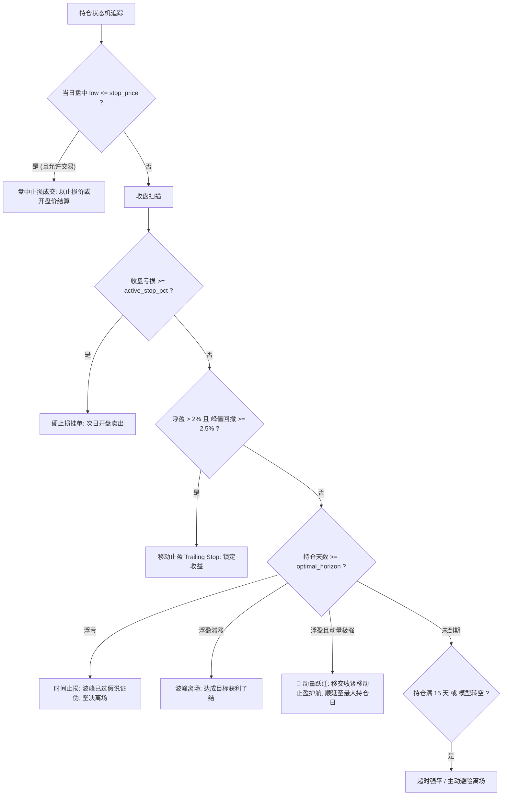

# Kronos-Pro 量化回测系统完全解析与实战手册

> 对应源码：`backtest/run_backtest_kronos_pro.py`  
> 多市场规则支持：`backtest/market_rules.py`  
> 批量回测调度：`backtest/run_backtest_batch.py`  
> 统一看板中枢：`backtest/app_backtest_dashboard.py`

---

## 目录

1. [系统架构与量化回测的第一性原理](#1-系统架构与量化回测的第一性原理)
2. [为什么需要 Pro 重构：普通回测的六大致命陷阱](#2-为什么需要-pro-重构普通回测的六大致命陷阱)
3. [六大核心数据结构全景流转](#3-六大核心数据结构全景流转)
4. [时序因果律与防偷价机制 (Anti-Lookahead)](#4-时序因果律与防偷价机制-anti-lookahead)
5. [AI 预测到信号生成：自适应 Z-Score 与动态去偏](#5-ai-预测到信号生成自适应-z-score-与动态去偏)
6. [多维度入场否决矩阵 (Veto Filter)](#6-多维度入场否决矩阵-veto-filter)
7. [真实市场摩擦建模与风险预算定仓](#7-真实市场摩擦建模与风险预算定仓)
8. [离散状态机与多维非对称出场防守](#8-离散状态机与多维非对称出场防守)
9. [双重评价体系：AI 预测体检与量化绩效指标](#9-双重评价体系ai-预测体检与量化绩效指标)
10. [Walk-Forward 滚动前向推演体系](#10-walk-forward-滚动前向推演体系)
11. [交互生态：CLI 快速使用与 Streamlit 交互看板](#11-交互生态cli-快速使用与-streamlit-交互看板)

---

## 1. 系统架构与量化回测的第一性原理

### 1.1 回测的本质
量化回测（Backtesting）的本质是：**在历史时间序列上，带着预设的初始资金，按照一套可量化的确定性规则模拟下达交易指令，并实时跟踪账户现金与持仓资产的变化。**

任何量化回测系统，剥去复杂的前端展示和数学指标后，底层的极简状态机仅包含 3 个核心变量：
- **`cash`（现金账户）**：当前账户内可供调配的自由资金。
- **`shares`（持仓股数）**：当前持有的标的股份总数（A 股必须为 100 股整手）。
- **`cost_basis`（持仓成本）**：建仓与加仓的成交均价。

在每个交易日收盘时，执行**逐日盯市（Mark-to-Market）**：
```text
账户总资产 (portfolio_value) = 现金 (cash) + 持仓股数 (shares) * 当日收盘价 (close)
```

### 1.2 最小可行回测原型 (30行代码)
理解整个 4000 行工业级脚本的第一步，是看懂它的极简骨架：

```python
import pandas as pd

def minimal_backtest(df: pd.DataFrame, initial_cash: float = 100000.0):
    cash = initial_cash
    shares = 0
    records = []

    for date, row in df.iterrows():
        close = row['close']
        signal = row['signal']  # 1 为买入，0 为空仓观望

        # 1. 执行交易动作
        if signal == 1 and shares == 0:
            shares = int(cash // close)       # 满仓买入
            cash -= shares * close
        elif signal == 0 and shares > 0:
            cash += shares * close            # 全部平仓
            shares = 0

        # 2. 逐日盯市结算
        portfolio_value = cash + shares * close
        records.append({
            'date': date,
            'portfolio_value': portfolio_value,
            'cash': cash,
            'shares': shares,
            'close': close
        })

    return pd.DataFrame(records).set_index('date')
```

以上最小原型仅展示了资金与持仓的数学关系。真实市场如果按此执行，会导致回测收益极高、实盘迅速亏损。

---

## 2. 为什么需要 Pro 重构：普通回测的六大致命陷阱

`run_backtest_kronos_pro.py` 的诞生，是为了彻底消灭传统初级回测代码中的 6 大经典陷阱：

| 陷阱类型 | 初级脚本的错误做法 | Pro 版本的工业级解决方案 |
| :--- | :--- | :--- |
| **未来函数 (偷价)** | 用当日收盘价预测，在当天开盘甚至收盘直接成交 | **严格时点约束**：t-1 收盘已知信息推理，t 日开盘执行 |
| **虚假样本重叠** | 历史数据止于今日，预测数据位于未来，区间脱节 | **强制重叠门禁**：历史 ∩ 预测 必须 >= 10 天，否则拒绝运行 |
| **信号死锁** | 使用 `signal.ffill()` 填充，一次买入后无状态管理 | **离散状态机**：跟踪每笔持仓天数、最高价、止损位 |
| **无视真实摩擦** | 随意买入小数股，零滑点，零手续费，不限涨跌停 | **真实摩擦建模**：100股整手、万三佣金(最低5元)、印花税0.05%、滑点0.1% |
| **缺乏主动防守** | 信号不消失就死扛，单次回撤 -30% 以上 | **多维防御**：盘中止损、ATR自适应硬止损、移动止盈、波峰离场 |
| **单点静态预测** | 仅依赖历史单次推演，无法适应市场动态切换 | **Walk-Forward 滚动前向预测**：步进滑动窗口模拟真实交易 |

---

## 3. 六大核心数据结构全景流转

整个系统数据在 6 个核心对象中单向流转：

```text
[1. 历史数据 hist_df] + [2. AI预测 pred_df]
                    ↓
           [3. 信号矩阵 signal_df]
                    ↓
[4. 逐日净值 backtest_df] + [5. 交易台账 trades]
                    ↓
           [6. 绩效评价 metrics]
```

### 3.1 原始历史行情 (`hist_df`)
* **含义**：标的在二级市场的标准日 K 线行情。
* **数据示例**：
```text
date (Index)        | open   | high   | low    | close  | volume     | amount
2026-06-23 00:00:00 | 27.200 | 27.850 | 26.900 | 27.500 | 1150000.0  | 31450000.0
2026-06-24 00:00:00 | 27.600 | 28.300 | 27.400 | 28.100 | 1420000.0  | 39680000.0
2026-06-25 00:00:00 | 28.200 | 29.000 | 28.000 | 28.800 | 1680000.0  | 48020000.0
```
* **生成方式**：由 `KronosDataFetcher.fetch_history()` 通过 AkShare / Yahoo Finance 拉取并标准化。
* **使用方式**：提供开盘成交价、盘中止损触碰价（low）、收盘盯市估值基准及历史波动率 ATR。

### 3.2 模型预测输出 (`pred_df`)
* **含义**：Kronos 深度学习模型推演出的未来路径统计特征。
* **数据示例**：
```text
date (Index)        | pred_close | pred_path_max | pred_min_down | optimal_horizon | pred_slope
2026-06-24 00:00:00 | 28.450     | 29.200        | -0.012        | 4               | 0.018
2026-06-25 00:00:00 | 28.920     | 29.800        | -0.008        | 3               | 0.025
2026-06-26 00:00:00 | 28.300     | 28.600        | -0.045        | 1               | -0.012
```
* **生成方式**：由 `KronosDataFetcher.walk_forward_predict()` 调用 `_summarize_paths()` 对 20 条蒙特卡洛预测路径提炼中位数、最大值及保守下探。
* **使用方式**：输入至 `align_and_generate_signals()` 计算期望收益、动态时界与下探风险。

### 3.3 信号对齐矩阵 (`signal_df`)
* **含义**：历史行情与预测数据对齐后，经过严格去偏、归一化与否决矩阵过滤后的交易决策表。
* **数据示例**：
```text
date        | close_prev | pred_close | exp_ret_adj | vol_14d | signal_score | raw_signal | exec_signal | veto_reason
2026-06-24  | 27.50      | 28.450     | +3.12%      | 2.10%   | +1.485       | 1          | 1           | 
2026-06-25  | 28.10      | 28.920     | +2.65%      | 2.15%   | +1.232       | 1          | 1           | 
2026-06-26  | 28.80      | 28.300     | -1.82%      | 2.20%   | -0.827       | 0          | 0           | 去偏后预期收益为负
2026-06-27  | 28.50      | 28.900     | +1.40%      | 2.25%   | +0.622       | 0          | 0           | 信号强度未进滚动分位阈值
```
* **生成方式**：由 `KronosBacktesterPro.align_and_generate_signals()` 计算产出。
* **使用方式**：驱动撮合状态机进行开平仓判断。

### 3.4 逐日净值记录 (`backtest_df`)
* **含义**：回测全周期内每日收盘后的资产分布及净值波动走势。
* **数据示例**：
```text
date        | portfolio_value | cash       | shares | close | exec_signal | returns   | drawdown
2026-06-24  | 100,000.00      | 100,000.00 | 0      | 28.10 | 0           |  0.0000%  |  0.0000%
2026-06-25  | 100,780.20      |   2,978.40 | 3,400  | 28.80 | 1           | +0.7802%  |  0.0000%
2026-06-26  |  99,760.20      |   2,978.40 | 3,400  | 28.50 | 0           | -1.0121%  | -1.0121%
2026-07-02  | 105,478.38      | 105,478.38 | 0      | 30.10 | 0           | +5.7319%  |  0.0000%
```
* **生成方式**：由 `run_backtest_engine()` 事件循环每日收盘盯市计算。
* **使用方式**：绘制累计收益曲线、动态水下回撤图，并计算年化收益、夏普比率。

### 3.5 交易流水台账 (`trades`)
* **含义**：每次完整买入、平仓交易的结构化流水列表（`list[dict]`）。
* **数据示例**：
```python
[
    {
        'date': pd.Timestamp('2026-06-25'), 'action': 'BUY',
        'price': 28.228,          # 28.20 开盘价 * (1 + 0.1% 滑点)
        'shares': 3400,           # 满足 A 股 100 股整手
        'commission': 28.79,      # 万三佣金（保底 5 元）
        'pnl_pct': 0.0, 'holding_days': 0, 'reason': '信号开仓',
        'cash_balance': 2978.40
    },
    {
        'date': pd.Timestamp('2026-07-02'), 'action': 'SELL',
        'price': 30.170,          # 30.20 开盘价 * (1 - 0.1% 滑点)
        'shares': 3400,
        'commission': 82.02,      # 佣金 + 0.05% 印花税
        'pnl_pct': +0.0688,       # 真实单笔净收益率 +6.88%
        'pnl_cash': +6578.38,     # 净利润金额
        'holding_days': 5,
        'reason': '移动止盈(峰值回撤-2.5%)',
        'cash_balance': 105478.38
    }
]
```
* **生成方式**：在 `run_backtest_engine()` 内部的开仓逻辑与 `_sell()` 闭环中追加记录。
* **使用方式**：统计胜率、金额口径盈亏比、单笔平均收益与平均持仓周期。

### 3.6 绩效评价结果 (`metrics`)
* **含义**：全量化风险归因与投资组合综合评分字典。
* **数据示例**：
```python
{
    '累计收益率':    0.1582,       # +15.82% 总回报
    '年化收益率':    0.7240,       # +72.40% 复合年化（样本>=120天）
    '年化波动率':    0.2135,       # 21.35% 年化标准差
    '夏普比率':      3.2700,       # 日频超额年化夏普比
    '索提诺比率':    4.1200,       # 仅惩罚下行波动的收益风险比
    '卡玛比率':     12.4400,       # 年化收益 / |最大回撤|
    '最大回撤':     -0.0582,       # -5.82% 峰值最大跌幅
    '总交易笔数':    6,            # 完整买卖闭环笔数
    '胜率':          0.6667,       # 66.67%
    '盈亏比':        2.4500,       # 总盈利金额 / 总亏损金额
    '单笔平均盈亏':  0.0264,       # +2.64%
    '期末总资产':    115820.50     # 账户最终总市值
}
```
* **生成方式**：由 `KronosBacktesterPro.evaluate_metrics()` 计算得出。
* **使用方式**：CLI 控制台打印、Streamlit KPI 卡片展示。

---

## 4. 时序因果律与防偷价机制 (Anti-Lookahead)

### 4.1 偷价现象的本质与危害
在日频策略中，若在 6 月 25 日开盘 9:30 买入，依据却包含了 6 月 25 日下午 15:00 的收盘价或当天预测值，回测结果会产生暴利假象。在实盘中，该交易逻辑完全无法执行。

### 4.2 时点不变量 (Point-in-Time Invariant)
Pro 引擎确立了严格的时点不变量：
> **在交易日 t 开盘撮合时，所有可用的历史特征与预测，必须且仅能在交易日 t-1 收盘时点已完全产生。**

### 4.3 为什么使用 `shift(1)` 统一对齐？
为了使回测数据表的行索引（Index）直观对应**「实际可成交日 t」**，代码将所有截至 t-1 收盘计算出的历史统计指标进行后移：

```python
# 1. 波动率与真实波幅：截至 t-1 收盘计算，在 t 日使用
vol_raw = hist_work['daily_return'].rolling(window=14).std()
hist_work['volatility'] = vol_raw.shift(1)

atr_raw = true_range.rolling(window=14).mean()
hist_work['atr'] = atr_raw.shift(1)

# 2. 收益率锚点：t 日决策时的最新基准收盘价为 close[t-1]
hist_work['close_prev'] = hist_work['close'].shift(1)

# 3. 均线趋势指标：
hist_work['ma_fast'] = hist_work['close'].rolling(20).mean().shift(1)
hist_work['ma_slow'] = hist_work['close'].rolling(60).mean().shift(1)
```

**时间轴流转关系**：
```text
t-1 日 15:00 收盘
  ↓ 计算得到：截至 t-1 的 volatility、atr、close_prev 及 Kronos 预测值 pred_*[t]
  ↓ 判定生成：raw_signal[t]
t   日 09:30 开盘
  ↓ 撮合执行：以当日 open[t] 价格叠加滑点执行成交 (exec_signal = raw_signal)
```
整个数据流不存在任何未来数据泄漏。

---

## 5. AI 预测到信号生成：自适应 Z-Score 与动态去偏

### 5.1 蒙特卡洛多路径采样与特征解耦
Kronos 对目标日 t 推演生成形状为 `(sample_count=20, pred_len=10)` 的蒙特卡洛价格路径矩阵。
在提取特征时，`_summarize_paths()` 实现了**入场与止盈特征解耦**：

1. **入场基准 (`pred_expected`)**：
   * **原理**：取全部采样路径在推演区间内的无偏均值期望。
   * **动机**：严禁把路径波峰直接作为期望收益，否则会产生选择性偏差（选峰正偏），人为放大信号预期。
2. **止盈目标 (`pred_path_max`)**：
   * **原理**：对每一条采样路径先取最大值，再取这 20 个峰值的中位数。
   * **动机**：不能先跨路径求平均再取最大值，先平均会抹平尖峰，低估上涨潜力。
3. **最大下探 (`pred_min_down`)**：
   * **原理**：每条路径先取到达波峰前的最低价，再取 10% 保守分位数。
   * **动机**：用于衡量途中的最大潜在回撤，不能跨路径平均，保留尾部风险。
4. **动态时界 (`optimal_horizon`)**：
   * **原理**：各路径峰值出现日期的中位数加 1，作为预期波峰出现的时钟。

### 5.2 预期收益率与动态去偏 (Debias)
由于深度学习时序模型在大盘单边行情后容易产生系统性多头或空头偏置，代码设计了滚动去偏机制：

```python
# 1. 原始预期收益率
df['expected_return'] = (df['pred_close'] - df['close_prev']) / df['close_prev']

# 2. 滚动偏差统计（使用前 60 个交易日误差中位数，同样严格 shift(1)）
err = df['expected_return'] - (df['close'] - df['close_prev']) / df['close_prev']
bias = err.shift(1).rolling(60, min_periods=15).median()
df['pred_bias'] = bias.fillna(0.0)

# 3. 去偏后的真实有效预期
df['expected_return_adj'] = df['expected_return'] - df['pred_bias']
```

### 5.3 波动率的时界根号缩放 (Square-Root of Time)
对于持仓 1 天和持仓 4 天的交易机会，不能使用相同的波动率进行除法归一。依据方差的时间可加性原理：
```text
波动率扩展因子: vol_scale = sqrt(target_horizon)
扩展波动率: volatility_scaled = volatility * vol_scale
自适应信号得分: signal_score = expected_return_adj / volatility_scaled
```
`signal_score` 反映了该机会在扣除时间跨度噪音后的**信息比率（Signal-to-Noise Ratio）**。

### 5.4 滚动分位数自校准 (Adaptive Quantile Threshold)
不同股票在不同市场周期的波动分布各不相同，固定阈值（如 > 0.7）不具备普适性。
代码引入了滚动分位数门槛：
```python
# 计算该股票过去 60 个交易日自身的 80% 分位阈值
roll = df['signal_score'].shift(1).rolling(calib_window=60, min_periods=15)
df['entry_threshold'] = roll.quantile(entry_percentile=0.80)

# 只有进入自身前 20% 的强信号区间，才允许触发买入候选
buy_cond = df['signal_score'] > df['entry_threshold']
```

---

## 6. 多维度入场否决矩阵 (Veto Filter)

候选信号必须按顺序通过严谨的**否决矩阵**（Veto Matrix）。只要有一项不满足，立即置为 0，并记录具体被哪一项规则拦截：

```text
[候选条件] signal_score > entry_threshold
    ↓
[否决 1] 去偏预期收益必须 > 0              (否决原因: 去偏后预期收益为负)
    ↓
[否决 2] 预测路径全局斜率 pred_slope > 0    (否决原因: 预测斜率向下)
    ↓
[否决 3] T+N 规则与波峰可实现性            (否决原因: 预测波峰时界<=1日，T+1无法在波峰离场)
    ↓
[否决 4] 宏观均线趋势过滤                  (否决原因: 下跌趋势且无短期确认)
    ↓
[否决 5] 路径下探风险深度评估              (否决原因: 预测下探过深，仓位系数归零)
    ↓
[否决 6] 开盘涨跌停可交易性                (否决原因: 开盘封涨停无法买入)
    ↓
[最终开仓指令] raw_signal = 1
```

### 核心否决项深度剖析：
1. **预测路径斜率 (`pred_slope > 0`)**：
   对未来 10 天的均值路径进行全局一阶线性回归。若斜率为负，说明标的处于下行趋势中，即使次日微涨也是下跌中继，坚决不入场。
2. **T+1 波峰可实现性 (`target_horizon > 1`)**：
   在 A 股 T+1 交易制度下，如果模型预测波峰在第 1 天（明天），明天买入后由于 T+1 限制当天无法卖出，后天能卖时股价已过波峰回落，交易在物理上不可兑现，因此一票否决。
3. **大趋势过滤 (Regime Filter)**：
   若 20 日均线小于 60 日均线（空头排列），且最新收盘价未能站上 20 日均线，判定处于逆势接飞刀环境，予以否决。
4. **下探深度与仓位缩放 (`pred_min_down`)**：
   计算预测最大下探相对硬止损线的倍数：
   ```text
   depth = |pred_min_down| / hard_stop_loss
   ```
   - 若 `depth <= 1.0`：预期下探安全，`position_scale = 1.0`；
   - 若 `1.0 < depth < 2.0`：线性缩减仓位；
   - 若 `depth >= 2.0`：预期下探幅度超过硬止损的 2 倍，`position_scale = 0.0`，直接否决不买。

---

## 7. 真实市场摩擦建模与风险预算定仓

### 7.1 真实市场环境建模 (`MarketProfile`)
脚本对各市场的交易制度进行了全真模拟：
- **A 股 (`CN`)**：严格 100 股整手；T+1；卖方印花税 0.05%；双边佣金万分之三（单笔最低 5 元）；双向滑点 0.1%；开盘一字涨跌停不可交易。
- **港股 (`HK`)**：每手股数查表适配；T+0；双边印花税 0.10%；滑点 0.15%。
- **美股 (`US`)**：1 股为单位；T+0；无印花税；滑点 0.05%。

### 7.2 机构级风险预算定仓 (Risk Budgeting)
不采用传统全仓梭哈模式，而是根据止损空间反推下单股数：

```python
# 1. 确定本笔交易承担的风险资金额度（总净值的 1%）
risk_budget = portfolio_value * risk_per_trade * scale

# 2. 计算动态止损空间（价格距离止损价的百分比距离）
stop_distance = active_stop_pct * buy_price

# 3. 反推持股数量
raw_shares = risk_budget / stop_distance

# 4. 结合 80% 仓位上限与可用现金双重截断
raw_shares = min(raw_shares, cap_by_pct, cap_by_cash)

# 5. 向下取整为合规整手数（如 A 股整除 100）
shares_to_buy = profile.round_shares(raw_shares)
```

### 7.3 一手保底机制 (Min-Lot Guarantee)
对于高单价股票（如腾讯、茅台），若按 1% 风险预算算出的股数不足一手（如 35 股被截断为 0），会导致系统永远无法建仓。
**一手保底机制**保证：在账户资金充裕且不击穿总体最大仓位的前提下，允许保底买入 1 手，维持策略的正常运作。

---

## 8. 离散状态机与多维非对称出场防守



### 六重出场防守规则明细：

| 出场类型 | 触发条件 | 执行时点与价格 | 设计动机与原理 |
| :--- | :--- | :--- | :--- |
| **盘中止损** | 当日最低价 `low <= stop_price` | 当日即时按止损价（跳空则按开盘价）成交 | 避免极端闪崩行情，盘中第一时间止血 |
| **ATR 硬止损** | 收盘亏损达到 `active_stop_pct` | 次日开盘按开盘价叠滑点成交 | 基于 ATR 自适应确定止损线，防守底线 |
| **移动止盈** | 浮盈达 2% 门槛，且距最高价回撤 2.5% | 次日开盘成交 | 保护大幅浮盈利润，防止“坐过山车” |
| **时间止损** | 到达目标时界且处于浮亏 | 次日开盘成交 | 证明模型波峰预期落空，假说证伪，坚决止损 |
| **动量跃迁** | 到达目标时界、浮盈充足、回撤<1.5%且均线多头 | 取消强平，收紧移动止盈并顺延 | **让利润奔跑**：让主升浪牛股充分释放空间 |
| **跌停顺延** | 触发卖出信号但开盘一字跌停 | 顺延至下一可交易日 | 真实贴合 A 股无法卖出的流动性冲击 |

---

## 9. 双重评价体系：AI 预测体检与量化绩效指标

### 9.1 AI 预测能力前置体检 (`evaluate_prediction_skill`)
在回测执行前，代码对预测质量进行前置体检。若开启 `--require-skill` 且体检不通过，直接中断回测：

1. **IC (Information Coefficient，信息系数)**：
   预测收益率与实际收益率的 Spearman 秩相关系数。
   - `|IC| < 0.03`：判定接近白噪声，缺乏基本选时能力。
   - `t-stat < 2.0`：统计上不显著。
   - `IC < 0`：反向预测。
2. **方向命中率 (Directional Accuracy)**：
   预测涨跌方向与实际走势的一致概率。
3. **幅度比与幅度偏差 (Magnitude Calibration)**：
   `预测均值 / 真实均值`。若大幅高于 1，说明模型存在系统性虚夸收益的偏差。
4. **下探跌破率 (Breach Rate)**：
   实际最低价跌破预测保守下探值的比例，用于检验下探风控的边界有效性。

### 9.2 传统量化指标的严密修正
- **年化夏普比率**：
  采用日频超额收益均值除以日频标准差后再乘以根号 252 年化，避免了几何复利收益与算术波动率相除带来的虚高。
- **金额口径盈亏比**：
  以每笔交易的实际盈亏金额（元）进行统计，消除各笔交易仓位规模不同带来的等权百分比失真。
- **样本外年化门槛**：
  有效回测样本少于 120 个交易日时不予外推年化，防止把 20 天的偶然波动放大成年化几倍的荒谬数据。

---

## 10. Walk-Forward 滚动前向推演体系

### 10.1 步进滑动窗口机制
Walk-Forward 模拟了真实的实盘迭代过程：
1. 确定回测窗口（如最后 120 个交易日）；
2. 步长 `step_size=1`（逐日推演）或 `step_size=2`（跳步插值）；
3. 每次推演仅取截止推演日前 120 天真实 K 线送入 Kronos 模型；
4. 产出未来预测并记录，窗口向前滑动一天。

### 10.2 缓存指纹机制 (Cache Fingerprint)
为避免重复推演浪费显卡算力，系统为生成的预测文件建立了基于元数据哈希的 `.fingerprint` 校验文件：
```json
{
  "stock_code": "300418",
  "model_name": "NeoQuasar/Kronos-base",
  "test_days": 120,
  "lookback": 120,
  "forecast_horizon": "auto",
  "max_auto_horizon": 10,
  "step_size": 1,
  "sample_count": 20
}
```
当参数未变动时秒级复用本地缓存；加上 `--force-refresh` 参数时则强制重新推演。

---

## 11. 交互生态：CLI 快速使用与 Streamlit 交互看板

### 11.1 命令行 (CLI) 常用指令

```bash
# 1. 推荐：一键自动拉取数据 + 滚动预测 + 执行回测
python backtest/run_backtest_kronos_pro.py 300418 --auto

# 2. 港股与美股标的回测（自动匹配市场规则）
python backtest/run_backtest_kronos_pro.py 00700 --auto
python backtest/run_backtest_kronos_pro.py AAPL --auto

# 3. 自定义风控参数：硬止损 5%，移动止盈 3%，最大持仓 8 天
python backtest/run_backtest_kronos_pro.py 300418 --hard-stop 0.05 --trail-stop 0.03 --max-hold 8

# 4. 开启技能准入强拦截（体检不合格直接报错中止）
python backtest/run_backtest_kronos_pro.py 300418 --auto --require-skill

# 5. 股票池批量回测调度
python backtest/run_backtest_batch.py --auto --stock-file backtest/my_stocks.csv
```

### 11.2 Streamlit 交互式量化中枢
运行命令拉起可视化面板：
```bash
streamlit run backtest/run_backtest_kronos_pro.py
# 或统一量化研发看板
streamlit run backtest/app_backtest_dashboard.py
```

**看板特色功能**：
- **K 线与净值图连续十字光标吸附**：注入底层 JavaScript 脚本，打通 Plotly 多子图之间的时间轴光标同步。
- **逐笔交易买卖点标记与归因**：直观展示开仓买点（绿点）与平仓卖点（红三角），悬停即查平仓归因（硬止损、移动止盈、动量跃迁）。
- **参数即时热重载**：侧边栏支持动态拖动滑块调整止损点、滑点、佣金，秒级响应刷新。
- **预测 vs 实际回归散点图**：直观体检 AI 模型预测能力的校准线与拟合度。
